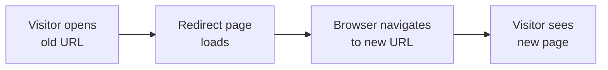

# Client-side redirects

Client-side redirects help site administrators and site maintainers keep published page addresses working after pages are moved or renamed. A redirect maps an old address to a new address so visitors automatically reach the right page instead of seeing a missing-page message. This protects search rankings, bookmarks, and links shared elsewhere.

## Status in this version

The application reviewed for this page is CodeKnit, a personal workspace for saving and organizing code snippets. The review found no client-side redirect capability in the provided project files. There are no redirect rules, no redirect pages, and no URL rewriting between old and new addresses in the reviewed code.

Because redirect support is not present, the configuration details previously published on this page could not be verified. Treat them as unconfirmed unless you can confirm them in a version that includes redirect support.

## Who it's for

When available, client-side redirects are for site administrators and site maintainers, the people who publish content, reorganize page addresses, rename pages, or migrate content. It benefits anyone who wants existing links to keep working after web addresses change.

## Intended outcomes

If a redirect capability is added, it would allow you to:

- Keep old page addresses working after pages are renamed or moved
- Send visitors automatically from an old address to the new page
- Preserve search engine rankings for moved pages
- Protect bookmarks and shared links from breaking
- Consolidate multiple old addresses into one new page

## What a redirect flow would look like

A redirect works by serving a short-lived page at the old address that immediately sends visitors to the new address.

Figure: Intended redirect flow

## What is not available in this version

The reviewed application does not provide:

- Old addresses pointing to one existing new address
- Automatic rewrites for common address patterns, such as adding or removing`.html`
- Automatically generated redirect rules for every existing page
- Automatic matching of trailing slashes at the end of addresses
- Automatic forwarding of query strings or anchors from the original request
- Duplicate address conflict detection
- Invalid destination warnings

None of those behaviors are supported by the reviewed code, so no verified options or limits can be documented at this time.

## What the application currently does

CodeKnit is a snippet workspace, not a redirect manager. You can:

- Open the **Project Dashboard** to view your snippet library
- Create, edit, view, delete, and favorite snippets
- Filter snippets by search term, language, category, and tag
- Browse sidebar sections such as **Dashboard**, **All Snippets**, **Favorites**, and **Recently Added**

The application stores your snippets in your browser and does not publish pages with redirectable addresses.
