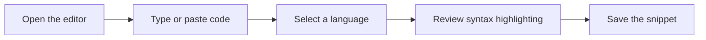
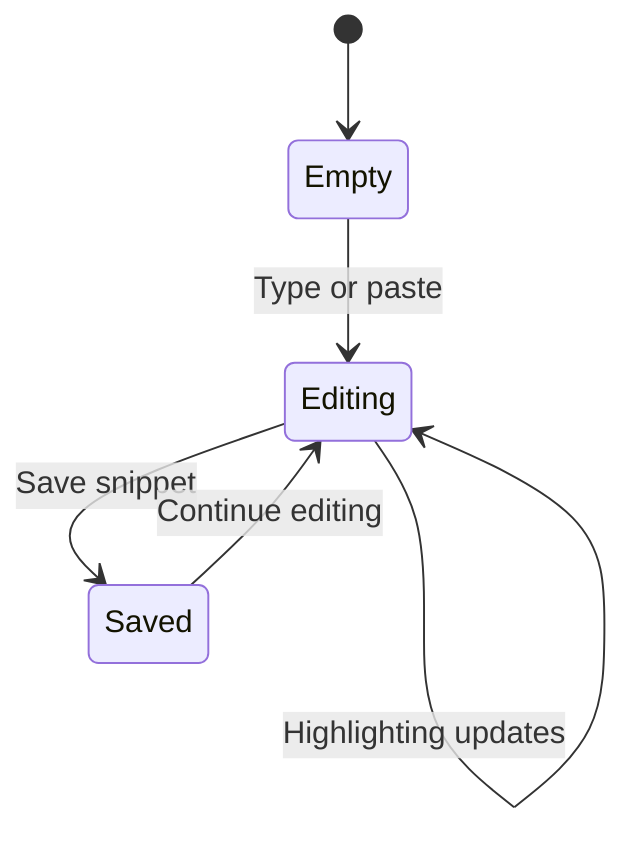

# Code editor

The code editor is where you write, paste, and refine code before saving it as a snippet. It gives you immediate visual feedback while you type, so you can see your code take shape without switching to another tool.

## Who it's for

The editor is for developers and anyone who works with code. Whether you are capturing a quick reference, drafting a new function, or cleaning up an existing snippet, the editor is the central place for composing your code.

## What you can do

### Write and paste code

You can type directly into the editor or paste code from another application. The text area accepts and displays your input as you work, making it easy to bring in code from your clipboard and refine it in place.

### See syntax highlighting as you type

As you enter code, the editor applies live syntax highlighting. Keywords, strings, comments, and other parts of your code appear in distinct colors, making the structure easier to scan and mistakes easier to spot.

### Choose a language for highlighting

The editor supports multiple programming languages. When you select a language, the highlighting adjusts to match that language's syntax, so your code is displayed with the appropriate visual cues.

### Compose snippet content

Everything you write in the editor becomes the content of your snippet. You can enter a small fragment or a longer block of code, and then store it with the rest of your saved snippets.

## How the editor fits your workflow

The following flow shows how the editor connects writing code to storing a snippet.

Figure: Composing and saving a snippet

The editor never works in isolation. It is closely connected to your snippet storage, so the code you compose can be kept for later use. For more on how snippets are stored, see Snippet Management.

## Key features

### Responsive design

The editor adapts to the screen you are using. You can work comfortably whether you are on a large display or a narrower window, and the text area remains a usable writing surface.

### Keyboard navigation

You can move through your code using familiar keyboard controls. Standard text-editing shortcuts let you position the cursor, select text, and correct mistakes without reaching for the mouse.

### Real-time visual feedback

Highlighting updates as you type, so you receive immediate confirmation that your input is being read and interpreted. This live feedback is one of the main benefits of the editor during code entry.

### Copy and paste support

Because the editor accepts pasted content, it works well with an everyday copy-and-paste workflow. You can take code from elsewhere, bring it into the editor, and then build on it.

## Editor states

As you work, the editor moves through a small set of states. The diagram below shows the most common ones.

Figure: Editor state changes

## Limitations and browser compatibility

The editor is a web-based input surface, not a full integrated development environment. Use it to compose, review, and store code rather than to debug, compile, or run your programs.

Because it runs in your browser, the editor depends on the browser's native text input and clipboard capabilities. Behaviors such as pasting from the clipboard or moving through text with keyboard shortcuts may vary slightly depending on which browser and operating system you use. For the most consistent experience, keep your browser up to date.
