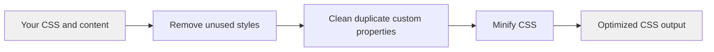

# CSS optimization

CSS optimization is a build-time feature that automatically minifies and compresses your site's CSS output. It removes redundant code, unused styles, and unnecessary characters so your stylesheets load faster. This feature is for developers who want smaller bundle sizes and better performance without manual configuration.

## What it does

When you run a production build with`npm run build`, the build tool processes your CSS through a series of optimization steps. You don't need to change your styles or add any configuration. The optimizer:

- **Minifies CSS files** by removing whitespace, comments, and unnecessary characters
- **Removes overridden custom properties** from your CSS, eliminating duplicate variable declarations that would never be used
- **Strips unused styles** by generating only the CSS classes your site actually uses
- **Shortens color values and numeric units** where it's safe to do so

The feature works automatically as part of the production build, so your normal development workflow remains unchanged.

## Key capabilities

### Automatic minification

Your CSS files are minified without any setup. The build tool removes comments, extra spaces, and line breaks. It also shortens common values, such as turning`#ffffff` into`#fff`, and consolidates repeated rules.

### Removal of overridden custom properties

A dedicated optimization step identifies duplicate CSS custom properties (often defined in a`:root` selector). When the same custom property is declared more than once, only the final definition is kept—earlier ones are removed because they would be overridden anyway. This respects`!important` rules: if you mark a custom property as`!important`, other definitions without that flag are removed.

### Unused style elimination

Because the site uses Tailwind CSS, only the utility classes that appear in your content are included in the final CSS. Styles that you never use are not generated at all. This keeps the stylesheet as small as possible.

## Benefits

- **Smaller bundle size**: Removes unused and redundant code, reducing CSS file size in typical projects
- **Faster page loads**: Smaller CSS files download and parse more quickly, improving perceived performance
- **Automatic process**: Runs with zero configuration during production builds
- **Safe optimizations**: Uses default build settings that preserve your visual styles

## Options and limits

### Configuration scope

CSS optimization uses the default build settings that are safe for most sites. The preset:

- Avoids risky transformations that could break code blocks or complex layouts
- Leaves vendor prefixing to your theme and build tools
- Preserves z-index values to avoid conflicts in layered interfaces

If you need advanced customization, you can extend the build configuration. See Site Building & Bundling for details.

## How it works

The optimization pipeline processes your CSS in this order during a production build:

1. **Unused style removal**: Tailwind CSS generates only the classes your content references
2. **Custom property cleanup**: Removes overridden CSS variables from the stylesheet
3. **Minification**: Applies standard minification to compress the remaining CSS

Figure: CSS optimization pipeline

This diagram shows how your CSS flows through the optimization pipeline during a production build, with each step reducing file size.
