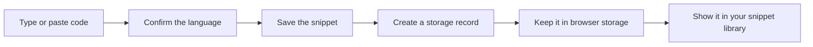
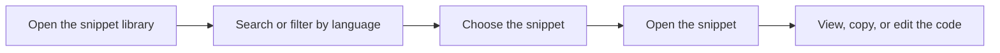
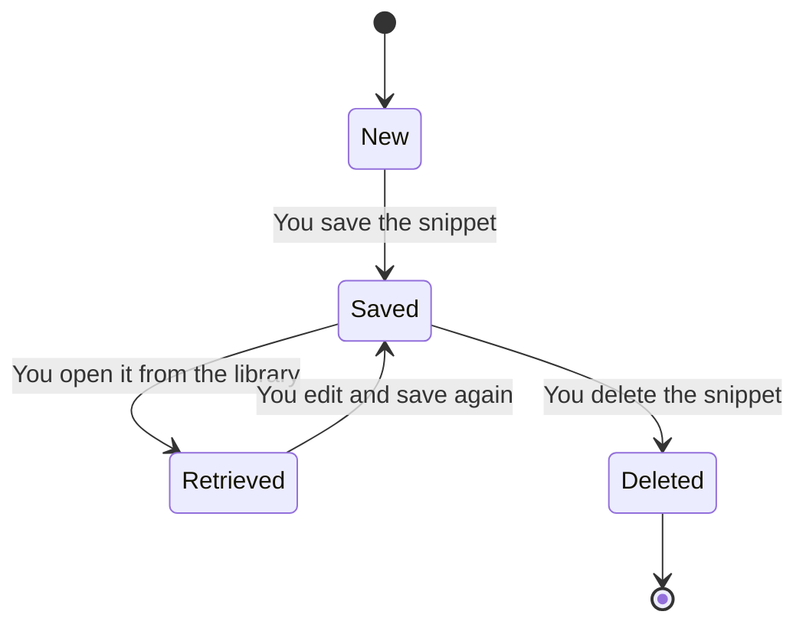
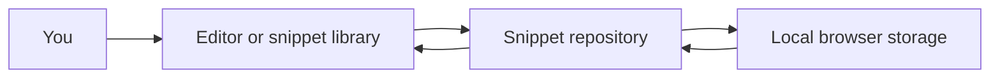
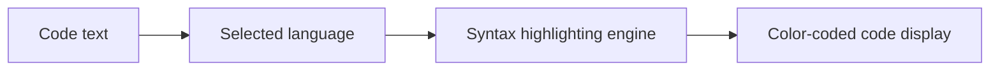
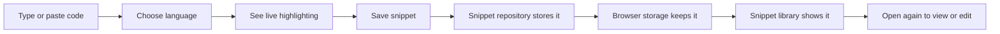

# How snippet storage and retrieval works

When you save a code snippet, the application keeps it available for you on the same device and browser. You don't need an account, and you don't need to connect to a server. This page explains what happens behind the scenes when you save, find, and reopen your snippets.

## Where your snippets live

Your snippets are stored locally in your browser. That means:

- A snippet you save in one browser stays in that browser.
- A snippet you save on one device does not automatically appear on another device.
- You can usually close the browser, reopen it, and still see your saved snippets.
- Clearing your browser data or using a private browsing window can remove or fail to preserve your snippets.

This local approach keeps your snippets private to your device and makes the application feel fast because it does not need to fetch data from the internet.

For more detail, see Data Storage.

## How saving works

When you create a snippet, the application takes what you entered and passes it through the built-in storage system. The storage system creates a record for the snippet and places that record in your browser's local storage.

Figure: Saving a new snippet

The saved snippet becomes part of your local library. You can see it on the Project Dashboard, filter it by language, or search for it later.

## How retrieval works

When you open your snippet library, the application reads from the same local storage. It loads the saved snippet records and displays them as your list of available snippets.

Figure: Retrieving a saved snippet

Because retrieval happens from local storage, the list appears quickly. The application does not need to contact an external service to show your saved snippets.

## Data persistence across sessions

Persistence means your snippets stay available after you close and reopen the application.

The storage system keeps snippets in your browser until one of these things happens:

1. You delete a specific snippet.
2. You clear your browser's stored data.
3. You use a browsing mode that automatically removes stored data when the window closes.

Under normal browsing conditions, closing the browser tab or the browser app itself does not delete your snippets. When you return to the application in the same browser, your snippet library should still be there.

Figure: Snippet lifecycle across sessions

## The role of the snippet repository system

The application uses a central snippet repository system to manage all snippet records. Think of this as the reliable middle layer between what you see on screen and where the snippet is actually kept.

When you save, edit, delete, or retrieve a snippet, the request goes through this repository. The repository knows where to store the data and how to return it to the interface.

In the current version, the repository stores snippets in your browser's local storage. The important part is that this storage choice is isolated. If the product later changes to use an online account or shared database, the visible experience for saving and retrieving snippets can remain the same.

Figure: How the repository connects the interface and storage

This separation means the application can improve its storage behind the scenes without requiring you to learn a new way to save or open snippets.

## How language selection and syntax highlighting work

When you create or edit a snippet, you choose or confirm the language for that code. The language choice affects how the application displays the text.

The application includes a built-in syntax highlighting engine. It does not rely on external highlighting tools, so you don't need to install anything extra.

Figure: Syntax highlighting workflow

The highlighting engine applies color and styling to make code easier to read. It supports common formats such as SQL and Markdown in addition to general code formatting.

The highlighted appearance is part of the editing and viewing experience. It does not change the underlying stored code; the storage system keeps the code exactly as you entered it.

For more detail, see Syntax Highlighting and Code Editor.

## How the pieces fit together

The complete path from typing code to seeing it highlighted and saved looks like this:

Figure: Complete snippet flow

This loop repeats for every snippet you save. The repository handles both saving and retrieval, so the interface stays consistent as you build up a local library.

## What to remember

- Snippets are stored only in the current browser on the current device.
- There is no account or server connection required.
- The snippet repository handles saving, editing, deleting, and loading snippets.
- Syntax highlighting is built into the application and supports formats such as SQL and Markdown.
- Clearing browser data can remove your snippets.

For step-by-step instructions, see Quick Start and How to Delete a Code Snippet.

Learn more about related features in Snippet Management, Data Storage, Syntax Highlighting, and Code Editor.
