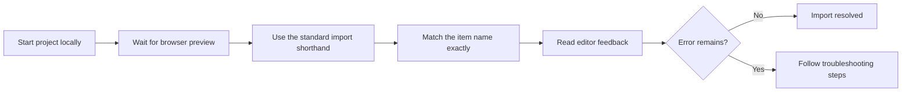
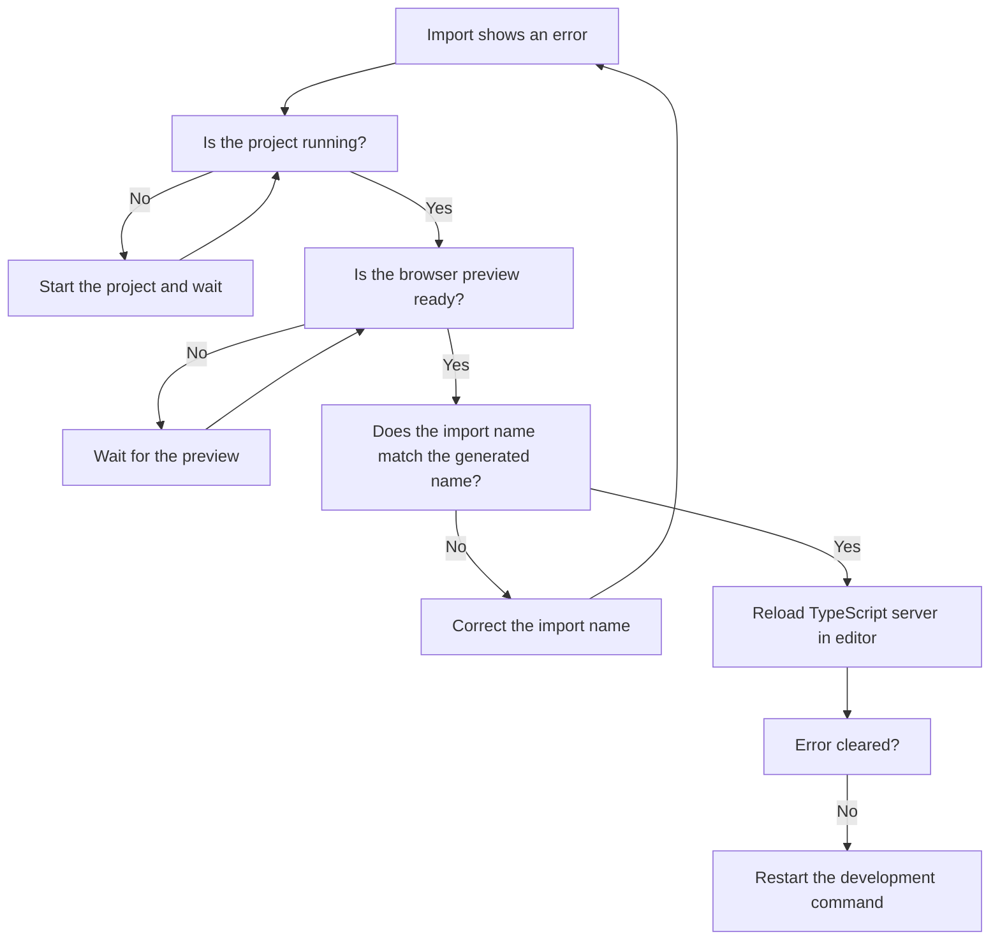

# How to avoid TypeScript errors when importing generated modules

This guide helps you keep your TypeScript workspace free of import errors when you reference items the project prepares for you. You'll learn the safest order of operations: prepare the project first, import second, and verify third.

## Prerequisites

Before you begin, confirm:

- The project is installed locally and opens in your editor.
- The development command works and produces a working browser preview.
- Your editor shows TypeScript feedback, such as colored underlines on problem areas.
- You know which item you need to import and its intended name.

## What generated modules are

When you start the project, the tooling creates supporting items automatically based on your current project layout. These items only exist after a successful preparation. Importing one before it is ready—or using a stale name—causes TypeScript to report it cannot find what you requested.

The project also supports a standard shorthand for imports, so you don't need to type long paths. This shorthand uses the at symbol followed by a forward slash. It appears consistently throughout the project whenever interface items, shared utilities, or saved snippet helpers are referenced. The shorthand only resolves correctly when the project preparation is active, which is another common source of confusion.

## Workflow at a glance

The diagram below shows the recommended path to a clean import experience.

Figure: Clean import workflow

After you finish the workflow, you should see a clean editor with no import-related underlines. The steps below expand on each stage.

## Steps

1. **Start the project in development mode.**
   Open a terminal, run the project's development command, and keep it running. This initial run prepares the generated items you may later import.

2. **Wait until the browser preview is ready.**
   Avoid adding imports while the project is still preparing. Once the browser window opens and the project loads fully, the supporting items are typically available.

3. **Use the standard import shorthand.**
   When you reference a project piece, use the same shorthand the rest of the project uses: the at symbol followed by a forward slash. This keeps your import consistent with the path recognition the project has already set up.

4. **Read your editor's inline feedback.**
   TypeScript shows a colored underline and a message when it cannot resolve an import. Hover over the underline to see whether the missing item is the module itself or just the name inside it.

5. **Match the generated name exactly.**
   Generated names are case-sensitive and use specific wording. A small mismatch—singular versus plural, different capitalization, or a missing word—triggers an error even when the module exists.

6. **Reload your editor's TypeScript understanding if errors persist.**
   Most editors offer a command to restart type checking or reload the workspace. Run that command, save the file, and check whether the underline disappears.

## Troubleshooting decision tree

When an import still shows an error, follow this order:

Figure: Import error troubleshooting flow

## Expected result

After following these steps, your imported items appear with no error underlines. You can save changes, move between files, and the import-related errors remain resolved. Other TypeScript feedback continues as normal, but the "cannot find module" and "name does not exist" style errors are gone.

## Common issues

- **The error says the module cannot be found.** In most cases, the project wasn't running yet or the browser preview wasn't ready when you added the import. Start the project and wait, then check again.
- **The error points to a name inside the module.** The module exists, but the name you used doesn't match the generated one. Verify the exact spelling, capitalization, and wording.
- **The error appears even though everything looks correct.** Your editor may be working from an older view of the project. Restart type checking in the editor or reload the workspace.
- **The import worked previously but not after a change.** The project's preparation refreshed and the generated item changed or moved. Re-run the development command so the generated pieces refresh.
- **The shorthand highlights as an error before you even type the module name.** The project preparation needs to be running for the shorthand to resolve. Confirm the development command is active and the preview is ready.
