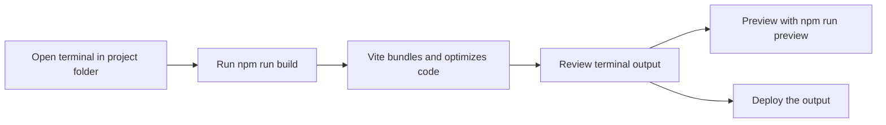

# How to build a production site

This guide explains how to create a production-ready build of your site. Running a production build bundles your application code, optimizes assets, and prepares output that's ready to preview, host, or deploy.

## Prerequisites

Before you begin, make sure you have:

- Node.js and npm installed on your computer (see System Requirements and Prerequisites)
- The project installed locally with all dependencies downloaded (see Installation and Setup Guide)
- A terminal open in the project folder

## Build steps

Figure: Production build flow



### 1. Open a terminal in the project folder

Navigate to the folder where the project is installed. This is the folder that contains the project files after you clone or download it.

### 2. Run the production build command

In the terminal, type the following command and press **Enter**:

```
npm run build
```

This starts the bundling process. The build tool takes your application source, processes it, and generates optimized output for production use.

### 3. Wait for the process to finish

The build runs automatically and prints progress messages as it works. Keep the terminal open until the process ends on its own. Do not interrupt the process unless you see an error message.

### 4. Review the output

When the build completes, check the final lines in the terminal. A successful build ends with a completion message and a summary of what was produced.

### 5. Preview the production build (optional)

To see how the production output behaves on your computer before deploying anywhere, run:

```
npm run preview
```

This starts a local preview server that serves the production build. Follow the terminal instructions to open the preview in your browser.

### 6. Create a development-mode build (optional)

If you need a build compiled in development mode rather than production mode, run:

```
npm run build:dev
```

Use this only when you specifically need a development-flavored build. For a standard deployment, use the production build command from step 2.

## Expected result

A successful production build:

- Ends without any fatal errors in the terminal
- Prints a summary confirming the build finished
- Produces output that you can preview with the preview command or deploy to a hosting service

## Common issues

### Build fails with an error

If the build stops with an error, read the message in the terminal carefully. It usually identifies the page, setting, or piece of content that needs to be fixed. Correct the issue, then run the build command again. See How to debug errors with detailed context for help interpreting the output.

### Build fails because dependencies are missing

If the terminal reports that a package or module cannot be found, the project's dependencies may not be installed. Close the terminal, then follow the setup steps in the Installation and Setup Guide to install all dependencies before trying the build again.

### Warnings appear during the build

Warnings may show in the terminal even when the build completes successfully. Review each warning to check whether it affects your site, and address it if needed. Warnings do not always prevent the build from finishing.

### Build takes a long time

Large sites with many pages and assets can take longer to build. Keep the terminal open until the process finishes on its own. To see detailed progress and status messages during the build, see How to view build progress and status messages.
