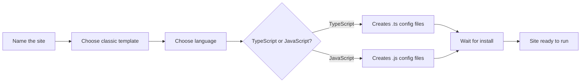

# How to choose between classic and TypeScript templates

When you scaffold a new documentation site, the tool asks which template and which language you want to use. This guide walks you through choosing the Classic template and deciding between the JavaScript and TypeScript versions.

The following diagram shows the sequence of choices you make during scaffolding:

Figure: Template and language selection flow

## Choose the classic template and your language

1. In the **What should we name this site?** prompt, type a name for your site or press Enter to use **website**.
2. In the **Select a template below...** prompt, choose **classic (recommended)**. The Classic template appears first in the list and is marked as recommended.
3. In the **Which language do you want to use?** prompt, choose one of the following:
   - **TypeScript**: creates the site using a TypeScript version of the Classic template, with full type checking and`.ts` configuration files.
   - **JavaScript**: creates the site using the standard JavaScript version with`.js` configuration files.
4. Wait while the tool creates the site structure. If you did not use the`--skip-install` flag, the tool automatically installs dependencies with your available package manager (npm, yarn, pnpm, or bun).

## What the classic template provides

The Classic template includes everything you need to start a documentation site: a docs section for your documentation, a blog for publishing articles, navigation bars, sidebars, and a styled theme. It is the recommended starting point for most documentation sites. Both the JavaScript and TypeScript variants include the same features and structure—the only difference is the language used for configuration and any custom code you write.

## Expected result

- A new site folder is created with the name you entered (or in the current directory if you chose`.`).
- If you chose **TypeScript**, the site includes TypeScript configuration files (`.ts`), offering type safety for any custom code or theme modifications you make.
- If you chose **JavaScript**, the site uses standard JavaScript configuration files (`.js`).
- The tool confirms success with a message showing the available commands:
  -`npm start` (or your package manager equivalent) to run the development server
  -`npm run build` to create a production build
  -`npm run serve` to preview the production build locally
- Your project is ready to customize immediately after scaffolding completes.

## Common issues

- **Directory not empty**: If the folder name you enter already contains files, the installer may warn you or refuse to overwrite them. Choose a different name or move existing files first.
- **Node.js version too old**: If your Node.js version does not meet the minimum requirement, installation may fail. Check the System Requirements and Prerequisites page for supported versions.
- **Package manager not detected**: If npm, yarn, pnpm, or bun is not installed, dependency installation fails. Install a package manager and run the scaffolding again.
