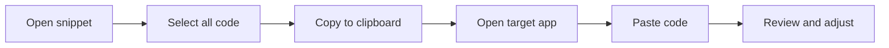

# How to copy Code from a snippet

This guide shows you how to copy code from a saved snippet so you can reuse it in another application, document, or project. The copy process is quick and preserves your code exactly as it appears in the editor.

## Before you begin

To copy code from a snippet, you need:

- At least one snippet already saved in the application
- The application open and the snippet you want to copy visible
- A destination application or editor ready to receive the copied code, such as a text file, an IDE, an email, or a chat message

## Copy code from a snippet

The following diagram shows the flow from opening a snippet through pasting it into a new location.

Figure: Copying a snippet to another application

1. Locate and open the snippet you want to copy. If you need help finding a saved snippet, see How to Find and Retrieve a Saved Snippet.

2. Click inside the code editor area to place your cursor in the code.

3. Select all the code by pressing **Ctrl+A** on Windows or **Cmd+A** on macOS. The entire snippet content is now highlighted.

4. Copy the selected code to your clipboard by pressing **Ctrl+C** on Windows or **Cmd+C** on macOS. The code is now stored on your device's clipboard.

5. Switch to your target application or editor, such as another code editor, a document, or a chat window.

6. Click in the area where you want the code to appear to place your cursor.

7. Paste the code by pressing **Ctrl+V** on Windows or **Cmd+V** on macOS.

## Expected result

After pasting, the code appears in your target application with the same line breaks, indentation, and text content as the original snippet. You can now edit, share, or run the code in its new location.

## Common issues and solutions

- **Formatting is lost after pasting.** Some applications apply their own formatting when you paste. Use the **Paste as plain text** option in your destination application to prevent unwanted styling.

- **Line breaks are not preserved.** If the pasted code appears as a single continuous line, check the paste options in your target application and choose a plain text or unformatted paste mode.

- **Syntax highlighting does not appear.** This is expected behavior. The color-coded highlighting in the snippet editor is display-only and does not carry over with the copied text. Your target application will apply its own highlighting after you paste.

- **Nothing pastes after you copy.** On some systems, clipboard access may be restricted. Try copying again and paste immediately afterward. If the issue persists, restart the application and repeat the steps.
