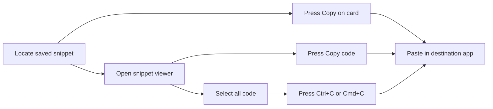

# How to copy code from a snippet

This guide shows you how to copy code from a saved snippet so you can reuse it in another application, document, or project. The app includes built-in copy buttons, so you can copy a full snippet with one click. You can also select the code manually if you only need part of it.

The following diagram shows the ways you can copy a snippet and paste it elsewhere.

Figure: Ways to copy code from a snippet

## Before you begin

To copy code from a snippet, you need:

- At least one saved snippet
- The application open with your snippets visible from **Dashboard** or **All Snippets**
- A destination application or editor ready to receive the copied code, such as another code editor, a document, an email, or a chat window

If you need help saving your first snippet, see Quick Start. For an overview of where snippets are stored and organized, see Snippet Management.

## Copy code with the built-in button

Each snippet card includes a **Copy** button that copies the entire snippet code to your clipboard.

1. Locate the card for the snippet you want to copy.
2. Press **Copy** on the card. The button changes to **Copied!** with a checkmark.
3. Open the destination application or editor where you want to use the code.
4. Click in the area where the code should appear.
5. Paste the code by pressing`Ctrl+V` on Windows or`Cmd+V` on macOS.

## Copy code from the snippet detail view

If you already have the snippet open, you can copy directly from the detail view.

1. On the snippet card, click the snippet title or press **View**.
2. In the snippet detail window, press **Copy code**. The button changes to **Copied!** with a checkmark.
3. Switch to your target application or editor.
4. Click where you want the code to appear.
5. Paste by pressing`Ctrl+V` on Windows or`Cmd+V` on macOS.

## Copy code manually

Use this method if you need to copy only part of the code or prefer to select the text yourself.

1. Open the snippet by clicking its title or pressing **View**.
2. Click inside the code display area.
3. Select all the code by pressing`Ctrl+A` on Windows or`Cmd+A` on macOS. To copy only part of the code, click and drag over the portion you need.
4. Copy the selection by pressing`Ctrl+C` on Windows or`Cmd+C` on macOS.
5. Switch to the destination application or editor.
6. Click where you want the code to appear.
7. Paste by pressing`Ctrl+V` on Windows or`Cmd+V` on macOS.

## Expected result

After pasting, the copied code appears in the destination application with the same text, indentation, and line breaks as the original snippet. If you used a built-in **Copy** or **Copy code** button, the entire snippet was copied automatically.

## Common issues and solutions

- **Formatting is lost after pasting.** Some applications apply their own formatting when you paste. Use the **Paste as plain text** option in the destination application to avoid unwanted styling.

- **Line breaks are not preserved.** If the code appears as one continuous line, choose a plain text or unformatted paste mode in the target application.

- **Syntax highlighting does not appear.** This is expected. The color-coded display in the app is visual only and does not carry over with the copied text. Your destination application may apply its own highlighting after you paste.

- **The copy button did not change to Copied!.** Try pressing the button again. If it still does not confirm, use the manual copy steps to select and copy the code.

- **Only part of the code was copied.** If you selected the text manually, make sure you selected the entire code block. To copy the full snippet, use the **Copy** button on the snippet card or the **Copy code** button in the detail view.
