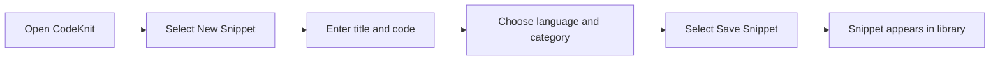

# How to create a new Code snippet

This guide walks you through creating and saving a new code snippet in CodeKnit. By the end, your snippet will be stored in your library and ready to use whenever you need it.

## Prerequisites

Before you begin, make sure you have:

- Access to the CodeKnit interface
- The code you want to save ready to paste or type
- A clear idea of what programming language your code uses

## Create a snippet

Figure: Code snippet creation flow

Follow these steps to create and save a snippet:

1. **Open CodeKnit.** When you launch the application, your Dashboard appears with the heading "Your code, organized." This is where your saved snippets live and where you start new ones.

2. **Open a new snippet form.** Select the **New Snippet** button in the header or sidebar. If your library is empty, you can also select **+ New Snippet** from the welcome message. A dialog titled **New snippet** opens.

3. **Name your snippet.** In the **Title **\*** field, enter a descriptive name that helps you recognize the snippet later. A good name describes what the code does, such as "Debounce utility."

4. **Paste or type your code.** Locate the **Code **\*** area, which shows the placeholder "Paste or write your code here." Click inside and paste your code, or type it directly. Indentation and line breaks are preserved as you enter them, and pressing Tab inserts two spaces.

5. **Select the programming language.** Use the **Language **\*** dropdown to choose the language that matches your code. You can pick from JavaScript, Python, SQL, or Markdown. JavaScript is selected by default, so change it if your code uses a different language.

6. **Add optional details.** Enter a **Description** to explain what the code does, choose a **Category** from the dropdown (or select **+ Custom category…** to create your own), and add **Tags** to make the snippet easier to find later. You can also toggle **Mark as favorite** to star the snippet for quick access.

7. **Save the snippet.** Select the **Save Snippet** button at the bottom of the dialog. A confirmation message appears, and the dialog closes.

## Expected result

After saving, your new snippet appears in **Your Snippets** on the Dashboard. It's now accessible anytime you open CodeKnit and is ready to be viewed, copied, edited, or organized. Snippets are stored in your browser, so they persist between sessions on the same device.

## Common issues and fixes

### The language is wrong

CodeKnit does not detect the language from your code—it always starts with JavaScript selected. If your code is in Python, SQL, or Markdown, open the **Language** dropdown and manually select the correct option before saving.

### Code formatting was lost

If indentation or line breaks look wrong, the issue is usually with the source you copied from, not the editor. Copy your code again from a plain-text source, or adjust the formatting manually in the editor.

### Snippet won't save

If nothing happens when you select **Save Snippet**, check for a red error message beneath the fields. All of these are required:

- **Title** must not be empty
- **Code** must not be empty
- **Category** must have a value

Fill in any missing required fields and try saving again.
