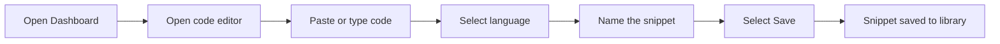

# How to create a new Code snippet

This guide walks you through creating and saving a new code snippet in API2. By the end, your snippet will be stored in your library and ready to use whenever you need it.

## Prerequisites

Before you begin, make sure you have:

- Access to the API2 interface
- The code you want to save ready to paste or type
- A clear idea of what programming language your code uses

## Create a snippet

Figure: Code snippet creation flow

Follow these steps to create and save your first snippet:

1. **Open the Dashboard.** When you launch API2, your main Dashboard appears. This is where your saved snippets live and where you start new ones.

2. **Open a new snippet editor.** Select the option to add a new snippet. The code editor opens with a blank text area ready for your input.

3. **Paste or type your code.** Click inside the editor and paste your code, or type it directly. Code formatting and indentation are preserved as you enter them.

4. **Select the programming language.** Use the language selector to choose the language or syntax type that matches your code. This ensures syntax highlighting displays correctly.

5. **Name your snippet.** Enter a descriptive name that helps you recognize the snippet later. A good name describes what the code does.

6. **Save the snippet.** Select the **Save** button to store the snippet in your library.

## Expected result

After saving, your new snippet appears in your snippet library on the Dashboard. It's now accessible anytime you open API2 and is ready to be viewed, copied, edited, or organized.

## Common issues and fixes

### Your language wasn't detected correctly

If the code doesn't highlight as expected, manually select the correct language from the language selector. API2 may not always guess the language from your pasted code.

### Code formatting was lost

If indentation or line breaks look wrong, the issue is usually with the source you copied from, not the editor. Copy your code again from a plain-text source, or adjust the formatting manually in the editor.

### Snippet won't save

If nothing happens when you select **Save**, verify that storage is enabled for your session. Without storage active, snippets can't be persisted between sessions. Check that you have named the snippet and selected a language, then try saving again.

Once you've created a snippet, you can:

- How to Find and Retrieve a Saved Snippet, locate saved snippets in your library
- How to Edit an Existing Snippet, modify code you've already saved
- How to Copy Code from a Snippet, extract code for use in other projects
- How to Organize Snippets by Language, categorize snippets by programming language
