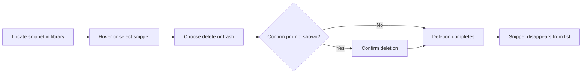

# How to delete a Code snippet

This guide walks you through removing an unwanted or obsolete snippet from your library. Deleting is permanent, so a confirmation step protects you from accidental loss.

## Prerequisites

Before you begin, make sure:

- You have the application open.
- The snippet you want to remove is visible in your snippet library.
- You are certain you no longer need the snippet, since deletion cannot be undone.

## Delete a snippet

The process below shows the full journey from locating the snippet to confirming it is gone.

Figure: Snippet deletion flow

1. Open your snippet library and locate the snippet you want to remove.

2. Hover over or select the snippet to reveal its available actions. Depending on your view, actions may appear beside the snippet or in an options menu.

3. Choose **Delete**, **Remove**, or the **Trash** icon. If you do not see the delete action immediately, look for an options menu (often shown as three dots) or open the snippet and look for the delete option there.

4. If you are asked to confirm, review the message and choose **Confirm** or **Delete** to proceed. This confirmation step is required for safety and prevents accidental loss.

5. Check your snippet list and confirm the snippet no longer appears. If you still see it, refresh or reload the list and verify again.

## Expected result

The snippet is removed from storage. It no longer appears in your library and is no longer accessible from the application.

## Common issues and fixes

| Issue | What to do |
| --- | --- |
| You cannot find the delete button | Look for an options menu, a three-dot menu, or right-click the snippet to open a context menu. |
| You deleted the wrong snippet | Check your browser history or any available backup, since deletion is permanent. |
| The snippet still appears after deleting | Refresh or reload the list, then verify again. If it still appears, repeat the deletion steps. |

## Related resources

- How to Create a New Code Snippet
- How to Edit an Existing Snippet
- How to Find and Retrieve a Saved Snippet
- Features | Snippet Management
- FAQ
