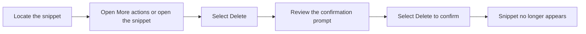

# How to delete a code snippet

This guide walks you through removing an unwanted or obsolete snippet from your library. Deleting is permanent, so a confirmation step protects you from accidental loss.

## Prerequisites

Before you begin, make sure:

- You have the application open.
- The snippet you want to remove is visible in your snippet library.
- You are certain you no longer need the snippet, because deletion cannot be undone.

## Delete a snippet

The process below shows the journey from locating a snippet to confirming it is gone.

Figure: Snippet deletion flow

1. Open your snippet library and locate the snippet you want to remove.

2. Open the snippet’s available actions. You can do this in two ways:
   - On the snippet card, select **More actions** (the three-dot icon), then choose **Delete**.
   - Select the snippet to open its full view, then choose **Delete** there.

3. Review the confirmation prompt. The dialog asks **Delete this snippet?** and warns that the snippet will be permanently removed and that this cannot be undone.

4. Select **Delete** to permanently remove the snippet. To keep the snippet, select **Cancel**.

5. Confirm the snippet no longer appears in your library. A success message appears when deletion is complete. If you still see the snippet, refresh or reload the list and verify again.

## Expected result

The snippet is removed from storage. It no longer appears in your library and is no longer accessible from the application.

## Common issues and fixes

| Issue | What to do |
| --- | --- |
| You cannot find the delete button | Select **More actions** (the three-dot icon) on the snippet card, or open the snippet and look for the **Delete** button in the full view. |
| You deleted the wrong snippet | Deletion is permanent and cannot be undone in the application. Before deleting, you can export a copy of your library from **Settings > Export library** so you have a backup. |
| The snippet still appears after deleting | Refresh or reload the list, then verify again. If it still appears, repeat the deletion steps. |

## Related resources

- How to Create a New Code Snippet
- Features | Snippet Management
- Features | Data Storage
- Frequently Asked Questions
