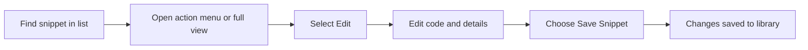

# How to edit an existing snippet

Editing a saved snippet lets you change its code, update its title or language, fix a description, or reorganize its tags without losing the original. Your edits are saved to the same library you already use for creating secrets, and they take effect as soon as you confirm them.

## What you need before you start

- At least one snippet already saved in your library
- The snippet you want to change visible in the Dashboard, All Snippets, Favorites, or Recently Added view

## Choose your path to editing

You can reach the edit view two ways:

- **From the snippet card**, open the action menu on the card and choose **Edit**
- **From the full snippet view**, open the snippet to see its details, then choose **Edit**

Both paths open the same **Edit snippet** dialog. The dialog is pre-filled with the snippet's current code, title, description, language, category, tags, and favorite status.

## Steps to edit a snippet

1. Locate the snippet you want to change in the snippet list.
2. Do one of the following:
   - Hover over the snippet card, select the **More actions** icon, and choose **Edit**
   - Or select the snippet card to open its full view, then select **Edit**
3. In the **Edit snippet** dialog that appears, make your changes in the code editor. The editor shows line numbers and syntax highlighting, and the **Tab** key inserts two spaces for indenting.
4. Optionally update the following fields:
   - **Title**, required, shown on the card and in search results
   - **Description**, a short explanation of what the snippet does
   - **Language**, choose from JavaScript, Python, SQL, or Markdown; this controls the highlighting
   - **Category**, select an existing one or choose **Custom category** to create a new one
   - **Tags**, add or remove labels for filtering
   - **Mark as favorite**, toggle the favorite switch to pin or unpin the snippet
5. Select **Save Snippet** to confirm your changes.
6. Look for the confirmation message **Snippet updated** at the top of the screen.

Figure: Editing a saved snippet flow

## Expected result

After you save, the snippet's card and full view show the updated code, title, description, language, category, tags, and favorite status. If the snippet's content changed, the card shows an **Updated** date instead of the original creation date. The changes remain available in your library the next time you open the application, because your snippets are stored locally on your device. To learn more about that, see Data Storage.

## Common issues and how to solve them

**My changes didn't save.**
Make sure you selected **Save Snippet** rather than **Cancel**. If you close the dialog with **Cancel**, your edits are discarded. Required fields, **Title**, **Code**, and **Category**, must be filled in before saving; otherwise an error message appears under the empty field.

**I still see the old version after editing.**
Your current view may not have refreshed yet. Close the dialog and check the snippet card again. If the old content remains, refresh the page in your browser and reopen the snippet.

**The syntax highlighting looks wrong after I changed the code.**
The highlighting follows the **Language** setting, not the code itself. In the **Edit snippet** dialog, open the **Language** selector and choose the language that matches your code. For example, switch to **Python** for Python code or **Markdown** for Markdown text.

**I accidentally entered a custom category and want to go back to a standard one.**
Select **Back** next to the custom category field to return to the predefined category list.
