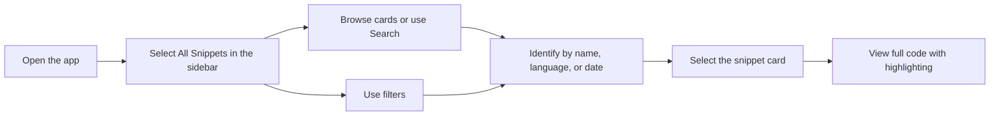

# How to find and retrieve a saved snippet

This guide walks you through locating and reopening a code snippet you have already saved. After you finish, the selected snippet appears with all its content intact and syntax highlighting applied.

## Before you begin

Make sure you have:

- Saved at least one snippet (see Quick Start for creating your first snippet)
- The application open

## Steps

Figure: Retrieving a saved snippet from the library

1. Use the sidebar to select **All Snippets**. This section shows your entire snippet library. You can also select **Favorites** or **Recently Added** to narrow the list.
2. Browse the snippet cards, each showing the snippet **name**, **language badge**, **category**, and the date it was created or last updated.
3. To narrow the list, type into the **Search** field at the top of the page. The search looks through snippet titles, tags, and code, so partial words work well.
4. Use the **Language**, **Category**, and **Tag** filters on the toolbar to refine results further. You can also sort by **Recently Added**, **Oldest First**, or **A–Z**.
5. Identify the snippet you want by its **name**, **language badge**, or **date**.
6. Click the snippet card, or click its **View** button, to open the full snippet view.
7. Review the complete code in the viewer, where syntax highlighting is applied automatically.

## Expected result

The selected snippet opens in the viewer with its complete code displayed exactly as you saved it. Syntax highlighting applies automatically so the code is easy to read. The snippet's name, description, language badge, category, tags, and creation/update dates remain visible for quick reference.

## Common issues and solutions

### The snippet doesn't appear in the list

- Confirm that your saved snippets were stored from a previous session and that storage is persisted.
- Refresh the page.
- Clear your browser cache and reload the application.
- Remove any active language, category, or tag filters that might be hiding the snippet.
- Check the sidebar to make sure you are viewing **All Snippets** rather than **Favorites** or **Recently Added**.

### Search doesn't find the snippet

- Search with a partial name instead of the full name.
- Check the spelling of the snippet name.
- Clear the search field and any active filters, then try again.

### Syntax highlighting doesn't display correctly

- Try opening the snippet in a different browser.
- Clear your browser cache and reload the page.
