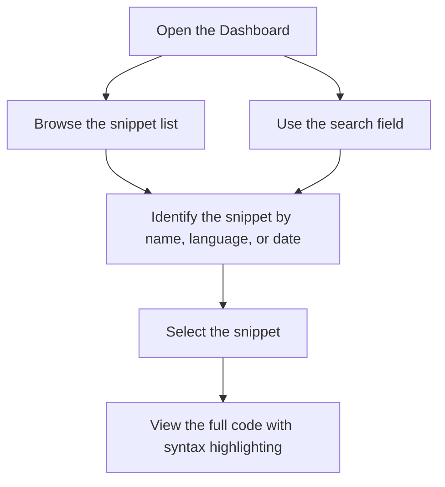

# How to find and retrieve a saved snippet

This guide walks you through locating and reopening a code snippet you have already saved. After you finish, the selected snippet appears with all its content intact and syntax highlighting applied.

## Before you begin

Make sure you have:

- Saved at least one snippet (How to Create a New Code Snippet)
- The application open

## Steps

Figure: Retrieving a saved snippet from the library

1. Navigate to the **Dashboard**, where your saved snippets are listed.
2. Browse the snippet list, or type in the **Search** field to narrow the results.
3. Identify the snippet you want by looking at its **name**, **language**, or **creation date**.
4. Select or click the snippet to open it.
5. View the full code and confirm that the syntax highlighting is applied.

## Expected result

The selected snippet opens with its complete code displayed exactly as you saved it. Syntax highlighting applies automatically so the code is easy to read. The snippet's name, language, and creation date remain visible for quick reference.

## Common issues and solutions

### The snippet doesn't appear in the list

- Confirm that your saved snippets were stored from a previous session and that storage is persisted.
- Refresh the page.
- Clear your browser cache and reload the application.
- Remove any active language filters that might be hiding the snippet.

### Search doesn't find the snippet

- Search with a partial name instead of the full name.
- Check the spelling of the snippet name.
- Clear the search field and any language filters, then try again.

### Syntax highlighting doesn't display correctly

- Try opening the snippet in a different browser.
- Clear your browser cache and reload the page.
