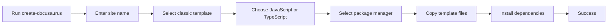

# How to generate project structure with default content

When you create a new website with the scaffolding tool, you get a ready-to-run starter that includes a landing page, a documentation section, a blog, and default theme styling. The generator copies a recommended template into a new folder and installs dependencies so you can start writing content right away.

## Prerequisites

Before you begin, make sure you have:

- Node.js installed on your computer
- A package manager such as`npm`,`yarn`,`pnpm`, or`bun`
- Access to a terminal or command prompt
- An empty location where you want the new website folder to appear

The generator warns you and stops if it detects an existing or non-empty folder at your chosen destination, so starting in a clean location avoids extra cleanup later.

## Generate a new project with default content

1. Open your terminal and navigate to the parent folder where you want the new website folder to appear.

2. Run the project generator:

```bash
   npx create-docusaurus@latest
   ```

   You can also specify the site name and starter template in one command:

```bash
   npx create-docusaurus@latest my-website classic
   ```

3. When prompted with **What should we name this site?**, type a name or press **Enter** to accept the default,`website`.

4. When prompted with **Select a template below...**, choose **classic (recommended)** from the list.

5. When prompted with **Which language do you want to use?**, choose **JavaScript** or **TypeScript**.
   - **JavaScript** gives you standard configuration files with plain JavaScript.
   - **TypeScript** adds type safety for configuration and custom code.

6. If more than one package manager is installed, select one from the **Select a package manager...** prompt. The generator automatically detects and uses the package manager associated with your environment when only one is installed.

7. Wait while the generator copies the template files and installs dependencies.

Figure: Scaffolding workflow from command to success



## Expected result

A new folder is created with the name you provided. Inside, you have a complete starter website that includes:

- **Home page**, a landing page with a hero section and feature highlights
- **Documentation section**, a structured docs area with sidebar navigation
- **Blog section**, example posts you can edit or replace
- **Configuration file**, default site title, navigation bar, footer, and theme settings
- **Package file**, dependencies and scripts for starting, building, and deploying
- **Theme styling**, custom CSS and syntax highlighting

When the generator finishes, it shows success instructions similar to:

```text
Created my-website.
Inside that directory, you can run several commands:

  npm start
    Starts the development server.

  npm run build
    Bundles your website into static files for production.

  npm run serve
    Serves the built website locally.

  npm run deploy
    Publishes the website to GitHub pages.
```

To view the new site, run:

```bash
cd my-website
npm start
```

The development server starts, and you can open the displayed local address in your browser to see the default website.

## Common issues

### The destination folder already exists or is not empty

The generator checks the target location before copying files. You may see one of these messages:

- **Directory not empty at path=/your/path**
- **Directory already exists at path=/your/path**

To resolve this, pick a different website name or remove the existing folder, then run the generator again.

### No package manager is available

If the generator cannot detect an installed package manager, it tries the default:

```text
No package manager available? Trying with npm
```

The generator falls back to`npm`. If`npm` is not installed, dependency installation fails. Install Node.js and npm before running the generator again.

### Dependency installation fails

If dependencies cannot be installed, the generator reports:

```text
Dependency installation failed.
The site directory has already been created, and you can retry by typing:

  cd my-website
  npm install
```

The website folder is still created with all template files. Retry the installation manually with the command shown. If it continues to fail, check your internet connection and package manager configuration.

### Invalid package manager choice

If you use the`--package-manager` option, the value must be one of:

-`npm`
-`yarn`
-`pnpm`
-`bun`

Example:

```bash
npx create-docusaurus@latest my-website classic --package-manager yarn
```

Any other value causes the generator to stop and show an error that lists the valid options.

### TypeScript is not available for the selected template

If you choose`--typescript` but the selected template does not include a TypeScript variant, the generator exits with a message similar to:

```text
Template classic doesn't provide a TypeScript variant.
```

Choose the JavaScript version of that template, or select a different template that supports TypeScript.

### Invalid git repository URL

If you use a git repository as the template source, the URL must start with`https://` or`git@`. The generator rejects URLs that do not match these patterns and reports that the repository URL is invalid. Provide a valid public git repository URL, for example`https://github.com/owner/repo.git`.

---

**Related topics:**

- How to choose between Classic and TypeScript templates
- Site Scaffolding overview
- Quick Start
- System Requirements and Prerequisites
