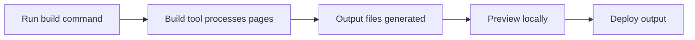

# How to generate redirect pages at build time

This guide explains how to run your project's build process and what that process produces for deployment. The build is the step that turns your site's content and configuration into the final files you publish.

## What you need before you start

- A local copy of the project with Node.js and npm installed
- A terminal or command prompt open in the project folder
- No running development server, so the build can use the latest files cleanly

## What happens during a build

When you run the build command, the project's build tool processes all of your pages and generates a production-ready version of your site that you can deploy.

Figure: Production build and preview flow



## Steps to run the build

### 1. Install the project dependencies

Open your terminal in the project folder and run:

```bash
npm i
```

This makes sure every dependency named in the project is present before you build.

### 2. Run the production build

In the same terminal, run:

```bash
npm run build
```

The build tool processes your site and writes the production output to the project's output folder.

### 3. Preview the production output

To see what the production build looks like before deploying, run:

```bash
npm run preview
```

This starts a local server that serves the build output so you can click through pages and verify everything works.

## Expected result

After the build finishes without errors, you have a production-ready set of site files in the project's output folder. You can preview those files locally with the preview command, then deploy that same output when you are ready.

## Common issues and solutions

**Build fails with missing dependencies**

If the build reports missing packages, run`npm i` again and retry the build. This ensures every dependency named in the project is present.

**Build output does not reflect recent changes**

Run the build command again from a clean start. If you were previously using the development server, stop it first so the build reads your latest files.

**Preview server does not show pages correctly**

Confirm the build finished successfully before running`npm run preview`. If the build had errors, the preview serves incomplete output.

**No redirect pages appear in the build output**

The build process available in this project does not generate redirect pages automatically. To create redirects, configure them through your site's redirect settings before running the build. See the related guides below for how to set up redirects for broken, legacy, or renamed paths.
