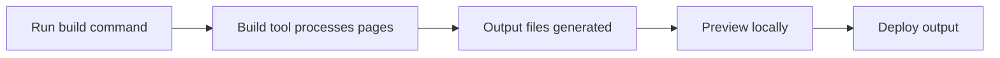

# How to generate redirect pages at build time

This guide explains how to run your project's build process and what that process produces for deployment. The build is the step that turns your site's content and configuration into the final files you publish.

## What happens during a build

When you run the build command, the project's build tool processes all of your pages and generates a production-ready version of your site that you can deploy. Any page generation that happens automatically as part of the build runs at this stage.

Figure: Production build and preview flow



## Steps to run the build

### 3. Preview the production output

To see what the production build looks like before deploying, run:

```bash
npm run preview
```

This starts a local server that serves the build output so you can click through pages and verify everything works.

## Common issues and solutions

**Build fails with missing dependencies**

If the build reports missing packages, run`npm install` again and retry the build. This ensures every dependency named in the project is present.

**Build output does not reflect recent changes**

Run the build command again from a clean start. If you were previously using the development server, stop it first so the build reads your latest files.

**Preview server does not show pages correctly**

Confirm the build finished successfully before running`npm run preview`. If the build had errors, the preview serves incomplete output.

**No redirect pages appear in the build output**

The build process available in this project does not generate redirect pages automatically. To create redirects, configure them through your site's redirect settings before running the build. See the related guides below for how to set up redirects for broken, legacy, or renamed paths.


Client-Side Redirects, Understand the available redirect options and configuration.

How to redirect broken or legacy URLs, Create redirects for old paths that visitors may still use.

How to handle page renames without 404s, Set up redirects when a page moves to a new URL.

Site Building & Bundling, Learn more about how the build process compiles your site.
