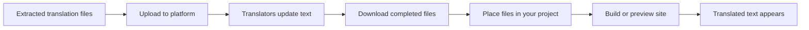
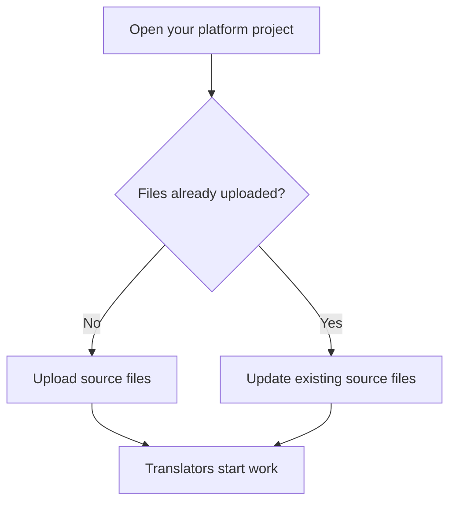

# How to integrate extracted translations with translation management

This guide shows you how to connect your extracted translation files to a translation management platform, send the source text out for translation, and bring the completed translations back into your project so they appear on your localized site. This page is part of Translation Extraction.

## Prerequisites

Before you begin, make sure you have:

- A project where translation messages have already been extracted. See How to extract translation messages from source code.
- Generated translation files for the languages you plan to support. See How to generate translation files for localization.
- An account with a translation management platform such as Crowdin, Transifex, POEditor, or a similar service.
- A project already created in that translation management platform.
- Access to the translation files on your local machine or in your repository.

Figure: Translation management integration flow

## Steps

### 1. Locate your extracted translation files

Open your project and find the translation files that were created during the extraction step. These files contain the source text strings your site displays. The extraction process groups them by language, so you should see a separate set of files for each locale you are working with.

### 2. Upload source translation files to your translation platform

In your translation management platform, open the project you created earlier. Upload the source translation files, the ones that contain the original text before any translation is applied. Most platforms accept the standard translation file formats directly, so you can upload them without converting anything.

Figure: Upload and sync decision flow

### 3. Add target languages

In your translation platform, add the languages you want to translate into. For each target language, the platform creates a translation task based on the source files. Pick the same languages you generated translation files for during the extraction step so everything stays aligned.

### 4. Invite translators or start translation

Invite team members to your translation platform project so they can begin translating, or use the platform's built-in machine translation service if one is available. Your translators work entirely in the platform—they do not need access to your code or your project files.

### 5. Download completed translations

When the translation work is complete, download the translated files from the translation management platform. Save them somewhere you can easily find, such as a dedicated folder on your computer.

### 6. Place the translated files in your project

Add the downloaded translated files to your project in the same location where your extracted translation files are stored. Match each translated file to its corresponding language and file name so the project can associate each translation with the right source text.

### 7. Verify the translations

Run a local preview or a full build of your site for each language you added. Browse the localized version of your site and confirm that the translated text appears in the interface instead of the original source text.

## Expected result

After completing these steps, you should see:

- Your translation management platform holds your source text and the completed translations for each target language.
- Your project contains the finished translation files for each language.
- When you preview or build your site in a target language, the translated text appears wherever the source text previously appeared.
- Future translation updates follow the same flow: update in the platform, download, then place the updated files in your project.

## Common issues

### Translated files are placed in the wrong folder

If your localization does not appear after following the steps, double-check where you placed the downloaded files. The translated files need to sit next to the source translation files under the matching language. If the folder name does not match the language code, the site may not recognize the translations.

### Source files and translated files are out of sync

If you add new text to your site after uploading source files to the translation platform, the translation platform will not know about the new text until you upload the updated source files again. Re-run the extraction step, upload the refreshed source files, and only then download the updated translations.

### Translations appear in the platform but not on the site

If the translation management platform shows completed translations but your site still shows the original text, confirm that you downloaded the files after the translations were finished and that you placed them in the correct location. Rebuild or restart the preview after placing the files.

### Some text remains untranslated

If only part of the interface appears translated, check the translation platform for strings that are still marked as untranslated, and verify that the downloaded files match the latest version of your source translation files. Strings added after your last upload will be missing from the downloaded files until you upload the updated source files and retrieve new translations.
