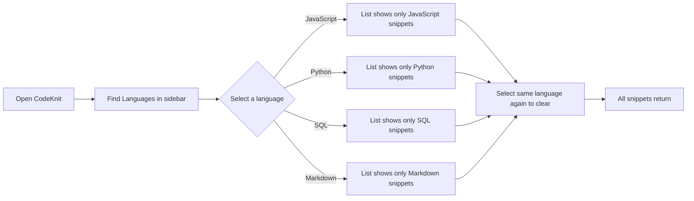
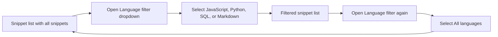

# How to organize snippets by language

This guide shows you how to filter your saved snippets by programming language so you can quickly find the code you need.

## What you'll learn

When you save several snippets in different languages, your library can quickly become crowded. CodeKnit lets you narrow the list to a single language, **JavaScript**, **Python**, **SQL**, or **Markdown**, so only the snippets you care about remain visible.

You can filter by language in two places:

- The **Languages** section in the left-hand navigation
- The **Language filter** dropdown in the filter bar above your snippet list

Both options work the same way and update the same list.

## Prerequisites

Before you begin, make sure:

- You have already saved at least two snippets in different languages
- You are viewing your snippet library on the **Dashboard** or **All Snippets** page

If you haven't created any snippets yet, see Quick Start for a guided walkthrough.

## Choose a language from the sidebar

The fastest way to filter is through the **Languages** section in the left-hand navigation.

1. Open CodeKnit and make sure the sidebar is visible. If it's hidden, select **Toggle navigation** at the top-left to reveal it.
2. Scroll down in the sidebar until you see the **Languages** heading.
3. Select the language you want to view, such as **JavaScript**, **Python**, **SQL**, or **Markdown**.

The snippet list immediately updates to show only snippets saved with that language. The selected language is highlighted in the sidebar, and the number of visible snippets appears next to the **shown** label.

4. To return to viewing all snippets, select the same language again. It acts as a toggle and resets the filter to **All languages**.

Figure: Language selection from the sidebar

## Use the language dropdown in the filter bar

You can also filter by language using the dropdown menu above the snippet list.

1. Open CodeKnit and navigate to **All Snippets** or your **Dashboard**.
2. Locate the filter bar directly above the snippet cards. It contains search, dropdown filters, and view options.
3. Select the **Language filter** dropdown. It opens a list showing **All languages** plus each supported language.
4. Choose a language from the list, such as **SQL** or **Markdown**.

The snippet list updates to show only snippets in that language.

5. To restore the full list, open the **Language filter** dropdown again and select **All languages**.

Figure: Language dropdown filtering flow

## Clear all active filters at once

If you have multiple filters active, for example, a language and a tag, you can clear them all with a single action.

1. Notice the **Clear Filters** button that appears in the filter bar whenever any filter is active.
2. Select **Clear Filters**.

This resets the language, category, tag, and search filters, while keeping your current sort order.

Alternatively, if no snippets match your selected language, the empty state page shows a **Clear filters** button you can use to reset everything.

## Results you can expect

After selecting a language, your snippet list shows only snippets saved with that language. Each snippet card still displays its language badge, making it easy to confirm the filter is working. The count shown near the page heading reflects the number of filtered snippets.

---

## Common issues

### The language filter is not visible

The filter bar is located directly above the snippet grid. If you don't see it, make sure you're viewing the **Dashboard**, **All Snippets**, **Favorites**, or **Recently Added** page. The filter bar appears on all of these pages.

### The filtered list appears empty

If you select a language and see the message **No snippets match**, you may not have any snippets saved with that language. Try selecting a different language or use **Clear Filters** to return to the full list.

### The filter doesn't seem to update

If the list hasn't changed after selecting a language, check whether the selected language is actually highlighted in the sidebar or selected in the dropdown. If it is and the list still appears stale, try clearing the filter and selecting it again. Refreshing the page restores the default **All languages** view.

---

## Related guides

- Snippet Management
- Project Dashboard
- Syntax Highlighting
- Glossary of Terms
- Quick Start
