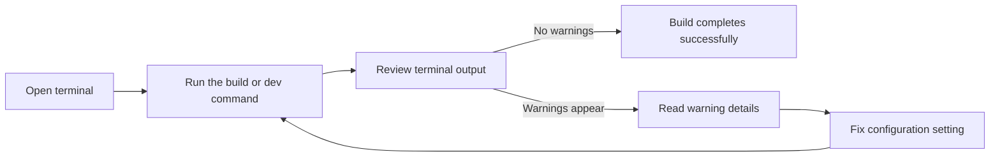

# How to receive warnings for configuration issues

When your project's configuration has a problem, the development and build commands report it in the terminal. This guide shows you how to run those commands, recognize configuration warnings, and confirm that an issue is resolved.

## Goal

Receive and understand configuration warning messages so you can identify and correct setup problems before they affect your project.

## Prerequisites

- The project is installed and its dependencies are available. See Installation and Setup Guide.
- You can open a terminal in the project folder.
- You know the current settings in your project configuration.

## How configuration warnings are displayed

The project provides several commands that check configuration as they run:

| Command | What it does |
| --- | --- |
|`npm run dev` | Starts the development server |
|`npm run build` | Creates a production build |
|`npm run build:dev` | Creates a development build |
|`npm run preview` | Previews the built project |
|`npm run lint` | Checks code style and quality |

Configuration warnings appear as text lines in the same terminal window where you run the command. They are not shown in the app itself. The warning text describes what is wrong and usually names the setting or option to check.

The workflow below shows what to do after you run a command.

Figure: Configuration warning workflow

## Expected result

When your configuration is correct:

- The command completes successfully.
- No warning lines appear in the terminal output.
- Your project builds or the development server starts.

When configuration issues exist:

- Warning lines appear describing the specific problems.
- The command may still finish, but your project may not behave as expected.
- Some severe issues may stop the command.

## Understanding warning messages

The exact wording of a warning depends on the command you run and the setting involved. In general, each warning includes:

- A description of the problem
- The configuration setting or option to check

There is no fixed list of warning messages in the provided source; each warning is produced by the tool you run. Read the full message and pay attention to the setting name it mentions.

## Common configuration warnings

The warnings you see depend on your project configuration and the command you run. Typical topics include missing or invalid values, options that are no longer supported, and conflicting settings. The warning text identifies the specific topic.

Common issues that can prevent you from receiving or acting on a warning include:

- **The command is not found.** Run the installation steps in Installation and Setup Guide, then try the command again.
- **Warnings pass by too quickly.** Scroll up in the terminal window to review the full output.
- **You see a warning that names an unknown setting.** Use the setting name from the warning to find and correct the configuration option.

## Related topics

- How to view build progress and status messages
- How to debug errors with detailed context
- Logging & Diagnostics
- Installation and Setup Guide
