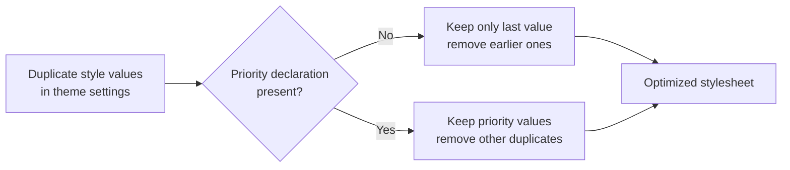

# How to remove unnecessary custom properties from CSS

Remove duplicate style values from your site's theme to reduce CSS size and improve performance when you publish your site.

## Goal

You want to eliminate redundant custom style values that are overridden by later declarations in your theme, so your published CSS is smaller and cleaner.

## Prerequisites

- Your site uses the CSS optimization feature
- Your theme defines custom style values
- You are publishing or building your site for production

## How it works

When you publish your site, the CSS optimization process automatically detects duplicate custom style values and removes the ones that are no longer needed. The process keeps only the value that actually takes effect:

- Without a priority declaration, only the last defined value is kept
- With priority declarations, all priority values are kept and only non-priority duplicates are removed

Figure: Removing duplicate style values from CSS

## Steps

1. Open your theme styles and add the custom style values you want to use. If the same value name appears more than once, the last one takes effect.
2. Publish or build your site to trigger the CSS optimization process.
3. Review the published stylesheet and confirm that duplicate values have been removed and only the effective value remains.

## Expected result

After a successful publish:

- Each custom style value appears only once
- The published stylesheet is smaller
- The correct cascade behavior is preserved
- Priority styles are retained

## Common issues

**Issue: My duplicate style values still appear**

Cause: The duplicates may be defined in different sections of your theme, not in the root theme area, or some of them use priority declarations.

Solution: The optimization process only removes duplicates from the root theme area. Duplicates in separate sections are intentional and are left alone. If priority declarations are used, all priority values are kept, and only non-priority duplicates are removed.

**Issue: A style value I needed was removed**

Cause: You defined the same value name more than once, and an earlier value was removed because a later one overrides it.

Solution: This is expected behavior, the last defined value always wins. If you need a different value in a specific context, define it in a more specific section instead of repeating it in the root theme area.

**Issue: My site doesn't seem to optimize CSS**

Cause: CSS optimization may be turned off, or your CSS is not being processed by the optimization step.

Solution: Make sure you are publishing or building for production, and check that CSS optimization is enabled in your site settings.
