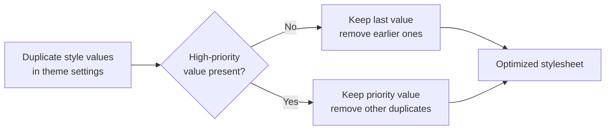

# How to remove unnecessary custom properties from CSS

Remove duplicate style values from your theme to reduce CSS size and improve performance when you publish your site.

## Goal

You want to eliminate redundant custom style values that are overridden by later declarations in your theme, so the published CSS is smaller and cleaner.

## Prerequisites

- Your site uses the CSS optimization feature
- Your theme defines custom style values
- You are publishing or building your site for production

## How it works

When you publish your site, the CSS optimization process detects duplicate custom style values and removes the ones that are no longer needed. The process keeps only the value that actually takes effect:

- For a regular value, only the last one defined is kept
- For a high-priority value, it is retained even when other duplicate values exist

Figure: Removing duplicate style values from CSS

## Steps

1. Open your theme styles and review the custom style values you have defined. Note any value that appears more than once.
2. Publish or build your site to trigger the CSS optimization process.
3. Review the published stylesheet and confirm that duplicate values have been removed and only the effective value remains.

## Expected result

After a successful publish:

- Each custom style value appears only once
- The published stylesheet is smaller
- The correct cascade behavior is preserved
- High-priority values are retained

## Common issues

**Issue: My duplicate style values still appear**

Cause: The duplicates may be defined in separate theme sections where they are intentional. They may also use high-priority values, which are always kept.

Solution: Duplicates in separate theme sections are left alone because they may be intentional. If high-priority values are used, they are retained by design.

**Issue: A style value I needed was removed**

Cause: You defined the same value name more than once, and an earlier value was removed because a later one overrides it.

Solution: This is expected behavior, the last defined value always wins. If you need a different value in a specific context, define it separately instead of repeating it.

**Issue: My site doesn't seem to optimize CSS**

Cause: CSS optimization may be turned off, or the CSS is not being processed by the optimization step.

Solution: Make sure CSS optimization is enabled, then publish or build again for production.
