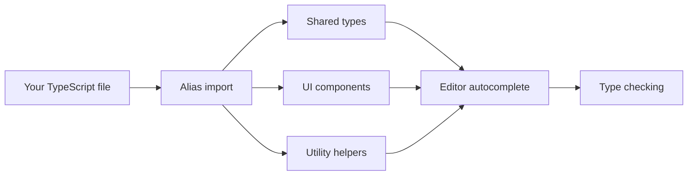

# How to type custom theme components and plugins

You can use TypeScript to add type safety to custom components and helpers in the CodeKnit app. This guide walks you through using the built-in shared types and the import alias system so your editor shows useful suggestions and catches errors as you write.

## Prerequisites

- Your project includes TypeScript (any`.ts` or`.tsx` file you're editing)
- You have access to the project's shared type definitions
- You understand basic TypeScript syntax and how to import modules
- Your editor supports TypeScript (VS Code or similar with TypeScript tooling)

## How module type aliases work

The project provides a dedicated import alias that maps to your source folders. Instead of writing long relative paths, you start an import with the alias and TypeScript resolves it to the correct location. The alias works for three main areas:

- **Shared types** for snippets and their structure
- **Reusable UI components** such as buttons and dialogs
- **Utility helpers** for formatting and styling

Figure: Module alias resolution flow



When you use an alias import, your editor reads the type definitions it points to. That gives you autocomplete suggestions, property names, and error messages based on the actual shape of the data or component you're using.

## Typed theme component example

Here's how to create a typed component that displays a snippet.

1. **Start a new TypeScript component file** in your project's component area.

2. **Import the shared snippet type** using the alias:

```typescript
   import type { Snippet } from "@/lib/snippets/types";
   ```

   The`Snippet` type describes every saved snippet: its title, description, language, code, category, tags, favorite status, and timestamps.

3. **Define a props interface** for your component:

```typescript
   interface Props {
     snippet: Snippet;
     onView: () => void;
   }
   ```

   This tells TypeScript exactly what properties and callback functions your component accepts.

4. **Type the component function** using the props interface:

```typescript
   export function SnippetItem({ snippet, onView }: Props) {
     return (
       <article onClick={onView}>
         <h3>{snippet.title}</h3>
         <p>{snippet.description}</p>
       </article>
     );
   }
   ```

   When you type`snippet.` inside this component, your editor lists only the valid properties:`title`,`code`,`language`,`category`,`tags`,`isFavorite`, and others. Misspelling a property shows an immediate error.

## Typed hook example

The built-in data hooks return typed values automatically through the same alias system.

1. **Import the snippet store hook** with the alias:

```typescript
   import { useSnippets } from "@/lib/snippets/store";
   ```

2. **Call the hook** and your editor shows the exact available properties:

```typescript
   const { snippets, status, error, reload, remove, toggleFavorite } = useSnippets();
   ```

   TypeScript knows that`snippets` is an array of`Snippet` objects, and that`status` is one of`"loading"`,`"ready"`, or`"error"`. When you check`status === "ready"`, the editor correctly narrows the type and lets you access`snippets` as ready data.

The same typed pattern applies to the filter helper. Importing it as`import { filterSnippets } from "@/lib/snippets/filter"` gives you a function whose parameters and return type match the`SnippetFilters` and`Snippet` types exactly.

## Available typed imports

The following imports come with built-in TypeScript types:

| Import | Key type | What it provides |
|--------|----------|------------------|
|`@/lib/snippets/types` |`Snippet` | Title, description, language, code, category, tags, favorite status, and timestamps |
|`@/lib/snippets/types` |`SnippetInput` | The fields needed to create or edit a snippet |
|`@/lib/snippets/types` |`SnippetFilters` | Query, language, category, tag, and sort options |
|`@/lib/snippets/types` |`Language` | One of`"JavaScript"`,`"Python"`,`"SQL"`, or`"Markdown"` |
|`@/lib/snippets/store` |`useSnippets()` | Snippet list, loading status, and action functions |
|`@/lib/snippets/filter` |`filterSnippets()` | Filtering snippets by active filters |
|`@/lib/snippets/highlight` |`TokenType` | Code syntax token categories for display |
|`@/lib/utils` |`cn()` | Combining class names with type-safe arguments |

## Check types in your editor

After you add types to your component, your editor shows:

- **Autocomplete suggestions** when you type`snippet.` or`config.`
- **Red squiggles** when you try to access a property that doesn't exist
- **Hover tooltips** showing the expected type and shape of each value
- **Inline errors** before you run or build the app

For example, hovering over`snippet.isFavorite` shows the property is a`boolean`, while hovering over`snippet.language` shows the exact set of supported language names.

## Common issues and solutions

**Issue: Your editor doesn't suggest properties for alias imports**

Make sure the path alias resolver is installed and active in your project. The project includes the`vite-tsconfig-paths` package in its dependencies, which resolves the alias. Restart your editor after installing dependencies.

**Issue: "Property does not exist on type Snippet"**

Check the exact property name. The snippet type uses`isFavorite` for the favorite flag—if you write`favorite` or`is_favorite`, TypeScript reports an error. The same applies to other fields: use`updatedAt`, not`updated` or`lastUpdated`.

**Issue: Type errors when assigning a literal value**

Some fields only accept specific string values. For example, the`Language` type accepts only`"JavaScript"`,`"Python"`,`"SQL"`, and`"Markdown"`. If you use a different string, TypeScript rejects it. Use one of the supported values or import the type and cast carefully.

**Issue: My component props interface is out of sync with the shared type**

When a field is part of the shared`Snippet` type, reuse that type instead of redefining it. For instance, a component that receives a snippet should declare`snippet: Snippet`, not`snippet: { title: string; code: string }`. Importing the shared type keeps your component automatically in sync when the underlying shape changes.

## Result

After following these steps, you have:

- Full TypeScript support for custom components and helpers
- Autocomplete and error checking for every property of the shared types
- Type-safe access to snippet data, filters, and store actions
- Clear, enforced prop contracts for reuse across the app
- Compile-time error checking before you run or build

---

**Related pages:**

- TypeScript Module Aliases, Overview of the module alias system
- How to get autocompletion for Docusaurus modules in TypeScript, Editor setup for autocomplete
- How to avoid TypeScript errors when importing generated modules, Fix common import errors
