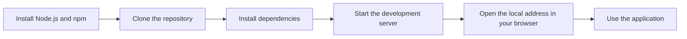

# Installation and setup guide

Follow these steps to get API2 running on your own computer. By the end, you’ll have a working local development environment where you can open the app, save code snippets, and see changes appear immediately.

Figure: Local setup flow



## Before you begin

1. Open your terminal.
2. Confirm that Node.js is installed by running:

```sh
node -v
```

If you see a version number, Node.js is ready. If the command isn’t recognized, install Node.js and npm first. For detailed setup help, see System Requirements and Prerequisites.

## Step 2: Install dependencies

1. While you’re inside the project folder, run:

```sh
npm i
```

**Expected output:** The terminal lists the packages being installed and returns to the command prompt when the installation finishes. This can take a few minutes.

## Step 4: Start the development server

1. In the same terminal, run:

```sh
npm run dev
```

2. Keep the terminal open while you use the app. If you want to stop the server later, press **Ctrl+C**.

**Expected output:** The terminal remains active and displays a local web address. While the server runs, the application refreshes automatically in your browser whenever you save changes.
