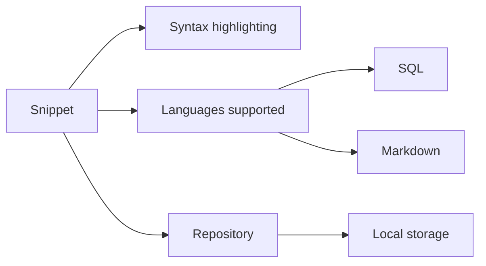
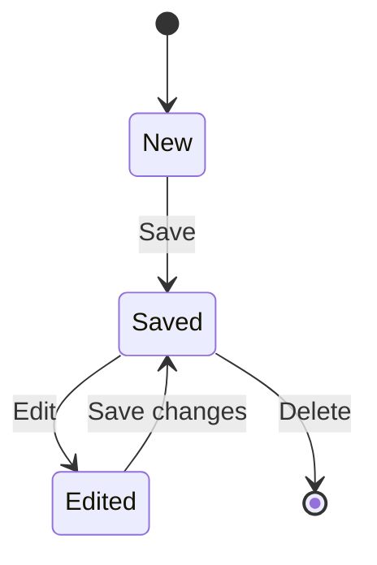

# Key concepts and terminology

This guide introduces the core ideas you'll meet as you use the snippet management application. Refer back to it whenever you come across an unfamiliar term or want to understand how the main parts of the product fit together.

## Core concepts

### Snippet

A snippet is a reusable piece of code that you save in the application for later use. Instead of rewriting the same SQL query or Markdown text every time you need it, you write or paste it once, save it, and retrieve it whenever you like. Each snippet stores the code itself together with its language type, so the application knows how to display and highlight it. See Snippet Management for more.

### Syntax highlighting

Syntax highlighting is the color-coded display of your code. When you open a snippet, the editor shows different parts of the code, such as keywords, strings, and comments, in distinct colors. This makes the code easier to read, helps you scan longer snippets quickly, and makes mistakes easier to spot. See Syntax Highlighting to learn more.

### Local storage

Local storage is where your snippets are kept on your own device. When you save a snippet, the application stores it in your browser's local storage, so your work stays available even after you close the application and come back later. Because storage is local, your snippets remain on your device rather than being uploaded to an online account, and they are tied to the browser and device you use. See Data Storage to understand how snippets persist between sessions.

### Languages supported

The application recognizes multiple language types for syntax highlighting, including SQL and Markdown. SQL is used for database queries, and Markdown is used for formatted text. When you choose a language for a snippet, the application applies the matching highlighting and display rules for that language. This also lets you group or filter your snippets by language. See How to Organize Snippets by Language for practical steps.

### Repository

The repository is the storage system that manages all of your snippets. It handles saving new snippets, retrieving existing ones, updating them, and removing them. In the current version, the repository works with your device's local storage, keeping all snippet data on your machine. This design also means the storage method can change in the future without changing how you use the application.

The following diagram shows how the core concepts relate to one another:

Figure: How the key concepts fit together

## Snippet lifecycle

A snippet moves through a simple set of states from the moment you create it until you remove it.

Figure: Lifecycle of a snippet

The typical journey looks like this:

1. You create a new snippet by writing or pasting code in the editor.
2. You save the snippet, and the repository stores it in local storage.
3. You can later find and open the snippet and edit it as needed.
4. When you no longer need a snippet, you can delete it, which removes it from storage.

## Glossary

| Term | What it means |
| --- | --- |
| **Snippet** | A reusable piece of code saved for later use |
| **Syntax highlighting** | Color-coded display of code based on the selected language |
| **Local storage** | The on-device storage in your browser where snippets are kept |
| **Languages supported** | The language types the application recognizes for highlighting, including SQL and Markdown |
| **Repository** | The storage system that manages saving, retrieving, updating, and removing snippets |

## Related topics

- Quick Start to create and save your first snippet
- Glossary of Terms for a broader list of definitions
- How to Edit an Existing Snippet to update saved code
