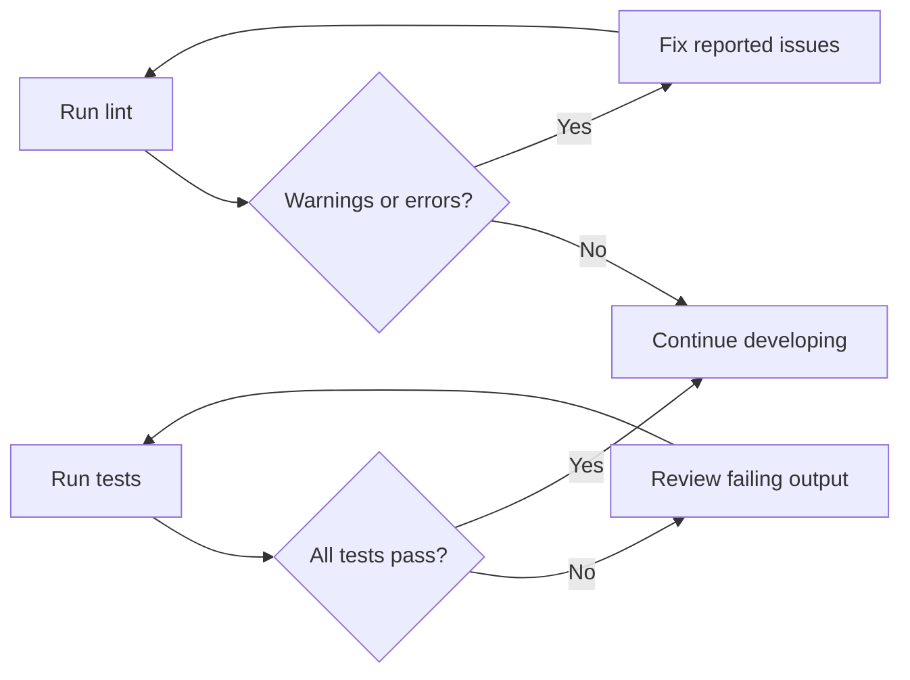
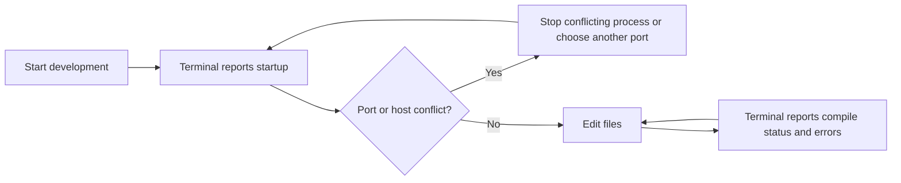

# Logging and diagnostics

Logging & Diagnostics is the built-in feedback system that reports what happens when you run project commands in the terminal, and surfaces problems while you work in the app. It is designed for developers who want to understand progress, catch code problems early, investigate test failures, inspect build output, and respond to runtime feedback such as failed save or delete actions.

The system covers:

- **Development and build output** from the commands used to run, compile, and preview the project
- **Code warnings and errors** from ESLint when you check code quality
- **Test results** from Vitest when you run test suites
- **Formatting checks** from Prettier when you want consistent output
- **In-app feedback** through pop-up messages when an action succeeds or fails

## What you can do with it

### Check code quality with ESLint

Run the lint command to scan all project files. The output separates issues by severity:

- **Errors** identify problems you should fix before proceeding.
- **Warnings** point to issues that do not stop the project but can affect quality or future maintenance.

Lint results include file names and a short explanation for each issue, so you can find and fix the source quickly.

### Run tests and review results with vitest

Run the test command to execute the full test suite once, or run the test watch command to continuously re-run tests as you modify files. The terminal output reports which tests passed, which failed, and what expectation was not met.

The output is most useful when you:

1. Run the full test suite before making a change to confirm a clean baseline.
2. Make the change, then run the suite again to catch regressions.
3. Review the failing test names and expectation messages shown in the terminal.

Figure: Test and lint feedback loop

### Build the project and watch progress

Run the production build command to compile the project. The terminal reports build progress and status messages, including warnings, errors, and a final success or failure result. When a build completes successfully, the output indicates that the compiled files are ready for deployment.

For a development-mode build, run the development build command. This variant produces output tuned for a development environment, which can be easier to inspect when you are diagnosing a build or loading issue.

### Preview the built project locally

Run the preview command to serve the compiled output on your local machine. The terminal reports the local address where the preview is available. This helps you confirm that the production build behaves correctly before you deploy it.

### Observe diagnostics during development

When you run the development command, the terminal reports startup progress and any port or host conflicts. While the development server is running, compile errors and update status appear in the terminal as you edit files.

Figure: Diagnostic outputs during local development

### Read in-app action feedback

When you save, update, delete, export, or reset a snippet, the app displays a small pop-up message confirming whether the action succeeded or failed. Failed loads also show an inline error area with a **Try again** option.

## Key diagnostic signals and what they mean

| Signal | What it tells you | What to do |
| --- | --- | --- |
| Lint error | Something is likely invalid or unsupported | Fix the reported file and issue |
| Lint warning | Something may affect code quality | Correct it if it affects your workflow, otherwise note it |
| Test failure | An expectation was not met | Review the reported test and expectation message |
| Build error | The project could not be compiled | Read the terminal output, fix the reported problem, and rebuild |
| Port conflict | The requested port is already in use | Stop the conflicting process or choose another port |
| In-app failure message | A snippet action did not complete | Read the message and retry the action |

## Limits to be aware of

- **No browser-based diagnostics panel** is built into the project. Logging and diagnostics are reported through terminal output for commands such as lint, test, build, preview, and development, plus brief in-app pop-up messages.
- **The project does not define custom log levels or structured log formats.** Feedback comes from the standard output of the configured development tools.
- **Diagnostic output is command-driven or action-driven.** You must run a command or perform an action to produce feedback; the project does not generate background diagnostics on its own.
- **In-app messages are intentionally brief.** For details such as test expectations or build errors, review the terminal output.
