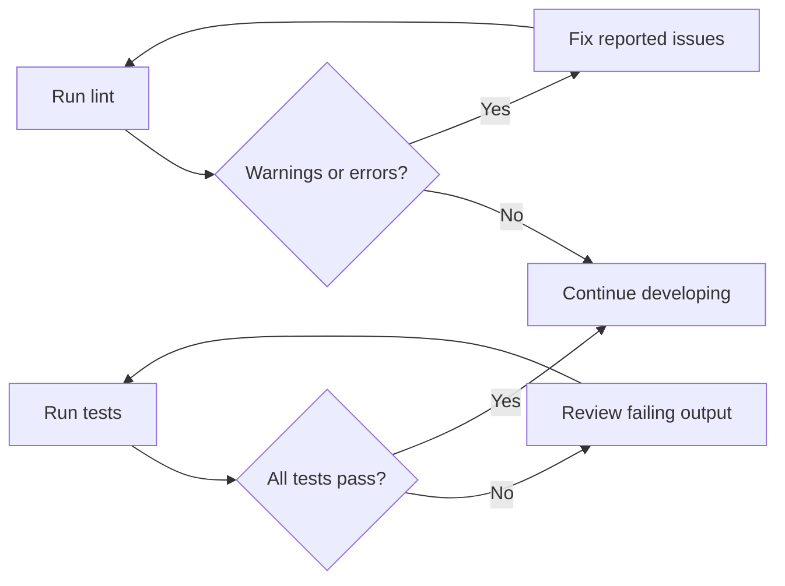

# Logging and diagnostics

Logging & Diagnostics is the built-in feedback system that reports what happens when you run project commands in the terminal. It is designed for developers who want to understand progress, catch code problems early, investigate test failures, and inspect where time and memory go during a build.

The system covers:

- **Development and build output** from the commands used to run, compile, and preview the site
- **Code warnings and errors** from ESLint when you check code quality
- **Test results** from Vitest when you run test suites
- **Environment checks** such as port, host, and strict-port detection during local development

## What you can do with it

### Check code quality with ESLint

Run the lint command to scan all project files. The output separates issues by severity:

- **Errors** identify problems you should fix. For example, importing the Next.js`server-only` module is rejected because this project uses the TanStack Start equivalent instead.
- **Warnings** point to issues that do not stop the project. For example, exporting something from certain components can disable fast refresh and is reported as a warning.

Lint results include file names and a short explanation for each issue, so you can find and fix the source quickly.

### Run tests and review results with vitest

Run the test command to execute the full test suite once, or run the watch command to continuously re-run tests as you modify files. The terminal output reports which tests passed, which failed, and what expectation was not met.

The output is most useful when you:

1. Run the full test suite before making a change to confirm a clean baseline.
2. Make the change, then run the suite again to catch regressions.
3. Review the failing file names and expectation messages shown in the terminal.

Figure: Test and lint feedback loop

### Build the project and watch progress

Run the production build command to compile the site. The terminal reports build progress and status messages, including warnings, errors, and a final success or failure result. When a build completes successfully, the output indicates that the output files are ready for deployment.

For an unminified build, run the development build command. This variant uses development mode, so the resulting output is easier to inspect when you are diagnosing a build or loading issue.

### Preview the built site locally

Run the preview command to serve the compiled output on your local machine. The terminal reports the local address where the preview is available. This helps you confirm that the production build behaves correctly before you deploy it.

### Observe diagnostics during development

When you run the development command, the terminal reports startup progress and any port or host conflicts. The server output signals when the local environment is ready.

## Key diagnostic signals and what they mean

| Signal | What it tells you | What to do |
| --- | --- | --- |
| Lint error | Something is likely incompatible or invalid | Fix the reported file and line |
| Lint warning | Something may affect quality or fast refresh | Correct it if it affects your workflow, otherwise note it |
| Test failure | An expectation was not met | Review the reported file and test message |
| Build error | The site could not be compiled | Read the terminal output, fix the reported problem, and rebuild |
| Port conflict | The requested port is already in use | Stop the conflicting process or choose another port |

## Limits to be aware of

- **No browser-based diagnostics panel** is built into the project. Logging and diagnostics are reported through the terminal output for commands such as lint, test, build, and development.
- **The configuration does not define custom log levels or structured log formats.** The project records its troubleshooting feedback through the standard output of the tools and commands.
- **Diagnostic output is command-driven.** You must run the relevant command to produce feedback; the tooling does not generate background diagnostics on its own.
