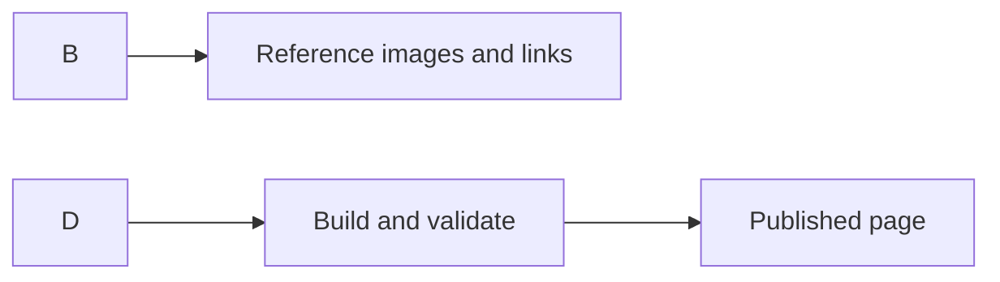

# MDX and markdown authoring

MDX and Markdown authoring lets you create documentation, blog posts, and pages using familiar Markdown syntax, then extend those pages with MDX when you need interactive React components, diagrams, and reusable content. It is for content authors who want a simple, predictable writing experience and for developers who want to embed custom functionality directly in a document.

Markdown provides everyday formatting for headings, lists, links, images, and code blocks. MDX extends Markdown by allowing React components inside the same document, so you can add interactive elements without leaving your writing flow.

## Who it is for

- **Content authors** can create pages, docs, and blog posts with standard Markdown. Images and links are checked automatically, and a table of contents is generated from headings.
- **Developers** can use MDX to embed React components, control how images and downloadable files are handled, and reuse smaller document parts in larger pages.

## What you can do

You can create content in Markdown or MDX files, add metadata through front matter, reference images and downloadable files, and add interactive elements. The following flow shows how a typical page moves from your content file to a published page.

Figure: Authoring workflow

### Write content with markdown and MDX

You can create documentation, blog posts, and pages as Markdown or MDX files. Markdown covers everyday formatting, while MDX allows you to include React components directly in the document. This means you can add interactive demos, custom UI elements, or embedded functionality next to regular text.

### Set document metadata with front matter

Each document can start with front matter, a block of metadata at the top of the file, that defines information such as the page title, description, and other page-level settings. The site validates this information against a schema and applies it consistently across your site. For a step-by-step guide, see [Write Markdown content with front matter](doc:a9bc6
