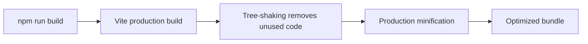
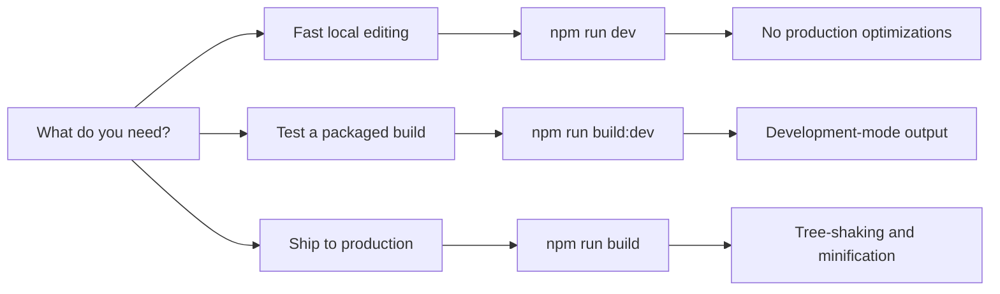

# Performance optimization

Performance optimization is a collection of build settings that make the application faster to build, smaller to download, and easier to deploy. It supports production and development build modes, automatic tree-shaking, a fast local development server, and a pinned bundler version for consistent, reproducible output.

## What you can do

### Benefit from automatic tree-shaking

The project's`sideEffects: false` setting tells the bundler that modules can be safely removed when they are imported but never used. This reduces the size of the final bundle by eliminating dead code automatically during production builds.

### Choose the right build mode for the job

You can run three distinct commands depending on what you need:

| Command | What it does | When to use it |
|---------|--------------|----------------|
|`npm run dev` | Starts a fast local development server | Everyday coding and testing |
|`npm run build` | Creates an optimized production bundle | Preparing to ship or deploy |
|`npm run build:dev` | Creates a development-mode bundle | Testing a build without production optimizations |

After a production build,`npm run preview` lets you serve the generated output locally so you can verify optimized performance before deploying.

## How it works

When you run a build, the system applies optimizations in stages. The diagram below shows the production build path.

Figure: Production build optimization flow

The development path is intentionally lighter. The diagram below shows how the three main commands differ.

Figure: Choosing the right optimization mode

## Benefits

**Smaller downloads**: Tree-shaking and production minification remove unused and redundant code, so end users download less data when the application opens.

**Faster local iteration**: The development server skips heavy optimization steps, keeping code-save-refresh cycles short while you build features.

**Consistent, predictable builds**: The pinned rolldown version eliminates variation caused by bundler updates, making builds reproducible across environments.

**Clear separation of concerns**: Having separate production, development build, and development server commands lets you pick the right balance of speed and fidelity for any task.

## Limits and considerations

**The development server skips optimization**:`npm run dev` does not apply the full production optimization pipeline. To evaluate real-world performance, run`npm run build` and then`npm run preview`.

**Development builds differ from production builds**:`npm run build:dev` produces output with development-mode settings, not the optimized production settings. Use it for testing or debugging, never for deployment.

**Tree-shaking requires a correct side-effects declaration**: With`sideEffects: false`, the bundler assumes any imported module without side effects can be discarded when unused. If you add a module that genuinely performs side effects on import, that module must be explicitly declared in the`sideEffects` list to avoid incorrect removal.

**Pinned bundler means manual updates**: The rolldown version stays at`1.2.1` unless you change the override yourself. This provides consistency, but you won't automatically receive newer bundler improvements.

**Production minification can slow builds**: Applying tree-shaking and minification takes more time than development builds. The trade-off is smaller output in exchange for a longer build step, which is why daily work happens in`npm run dev`.

## Related guides and features

- How to enable faster build mode
- How to target modern browsers for smaller bundles
- How to use Lightning CSS minifier for CSS
- How to use SWC minifier for JS
- Site Building & Bundling
- CSS Optimization
- System Requirements and Prerequisites
- Installation and Setup Guide
