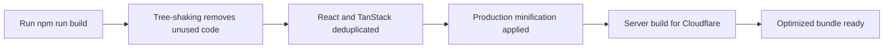

# Performance optimization

Performance Optimization is a set of build enhancements that make the application faster to build, smaller to download, and easier to deploy. It supports production and development build modes, automatic tree-shaking, package deduplication, and optimized server deployment through modern build tooling.

## What you can do

### Benefit from automatic tree-shaking

The project's`sideEffects: false` setting tells the bundler that modules can be safely removed if they are imported but never used. This reduces the size of the final bundle by eliminating dead code automatically.

## Key capabilities

**Production and development build modes**: Choose between`npm run build` for optimized production output and`npm run build:dev` for development builds. Each mode applies the optimization settings appropriate for its purpose.

**Automatic tree-shaking**: The`sideEffects: false` flag enables the bundler to remove unused modules during production builds, resulting in smaller files.

**Package deduplication**: React and TanStack packages are automatically deduplicated to ensure each library appears only once in the bundle. This reduces duplication and prevents version conflicts.

**Optimized server builds**: Server-side output is built with Nitro and targets Cloudflare by default, producing deployment-ready server code optimized for edge environments.

**Fast development server**: The development server (`npm run dev`) skips production optimization steps to keep your local iteration fast and responsive.

**Consistent bundler version**: The rolldown bundler version is pinned to`1.2.1` through the project overrides, ensuring reproducible builds and consistent performance characteristics.

**Environment-aware sandbox detection**: The build system automatically detects sandboxed environments and adjusts port, host, and strict-port settings so the application runs correctly across different scenarios.

## How it works

When you run a build command, the system applies optimizations in stages. The flow below shows the production build process.

Figure: Production build optimization flow

For a development build (`npm run build:dev`), the system uses development mode settings, which produce output closer to your development environment for testing and debugging.

## Benefits

**Smaller downloads**: Tree-shaking and minification remove unused and redundant code, so users download less data when they open the application.

**Faster builds**: The build pipeline uses modern bundling with rolldown, and the development server skips heavy optimization steps to keep iteration quick.

**Reliable output**: The pinned bundler version and automatic deduplication produce consistent, predictable builds every time.

**Cloudflare-ready server code**: Server builds are optimized for Cloudflare deployment by default, reducing the effort needed to ship the application to modern edge infrastructure.

## Limits and considerations

**Development server skips optimization**: The development server (`npm run dev`) does not apply the full production optimization pipeline. To evaluate actual performance, use`npm run build` and then`npm run preview`.

**Development build differs from production**: The`npm run build:dev` command produces a development-mode build with different optimization settings than the standard production build. Use it for testing, not for production deployment.

**Tree-shaking requires correct side-effects declaration**: With`sideEffects: false`, the bundler assumes any imported module without side effects can be removed if unused. Any module that genuinely has side effects must be explicitly listed to avoid incorrect removal.

**Pinned bundler version**: The rolldown override pins the bundler to version`1.2.1`. This provides consistency but means newer bundler improvements require a manual override update.

**Default server target**: Server builds default to Cloudflare. If you deploy to a different platform, you may need to adjust the server configuration.

## Related features

- Site Building & Bundling
- CSS Optimization
- System Requirements and Prerequisites
- Installation and Setup Guide
