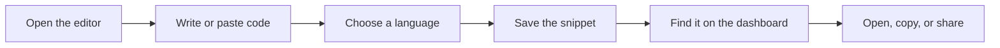
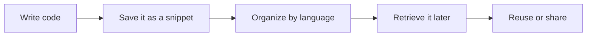

# API2 product overview

API2 is a code snippet management and sharing platform. It gives you a single, simple place to save pieces of code you want to keep, organize them so they're easy to find, and share them with the people you work with. Instead of hunting through old projects, chat threads, or scattered notes, you can store reusable code in API2 and return to it whenever you need it.

## Who it's for

API2 is built for people who write and work with code:

- **Developers** who want a personal library of go-to solutions, snippets, and examples
- **Engineers** who need to keep frequently used patterns close at hand
- **Technical teams** who want a shared place to store and distribute common code examples

If you regularly copy the same code from one place to another, keep notes full of code fragments, or ask teammates to re-send a snippet they shared before, API2 is designed to help.

## What you can do with it

### 1. Store code snippets

You can save code you've written, code you've found, or code you want to keep for later. Once a snippet is saved, it stays available for you to open and reuse. See Snippet Management for a deeper look at how saving and organizing works.

### 2. Organize code examples

API2 lets you group and filter snippets by programming language, so a growing collection stays manageable. You can find what you need without scrolling through everything. Learn how in How to Organize Snippets by Language.

### 3. Share with team members

When a snippet is useful to more than just you, you can share it with teammates so everyone works from the same example.

### 4. Read code more easily

Snippets are displayed with color-coded syntax highlighting, which makes structure, keywords, and values easier to distinguish at a glance.

Figure: The core snippet workflow

The diagram above shows the basic journey most people follow: you create a snippet, save it, and later come back to find and use it. Each of those steps is supported by a dedicated part of the product:

- The Code Editor is where you write or paste code and see live syntax highlighting
- The Project Dashboard is your home screen for managing and accessing saved snippets
- Data Storage keeps your snippets available between sessions

## Key differentiators

API2 stands out in three main ways:

- **Built-in syntax highlighting.** Your code appears with automatic, color-coded formatting rather than plain black-and-white text, making it faster to read and review.
- **Easy storage.** Snippets persist between sessions, so your collection is still there when you come back.
- **Simple organization.** You can keep snippets organized by programming language without setting up complicated filing systems.

Figure: How API2 fits into your daily work

## Core value proposition

API2 reduces the time you spend re-finding code you already have. Instead of recreating a function from memory, asking a teammate again, or searching old repositories, you can save the snippet once and come back to it in seconds. For teams, a shared snippet library also helps keep examples consistent across projects.

In short, API2 is for anyone who wants a lightweight, readable, and dependable place to keep the code they use most.
