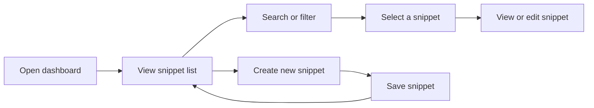
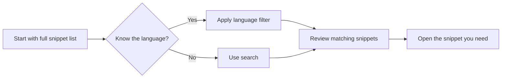

# Project dashboard

The Project Dashboard is your central workspace in the application. It brings together everything you need to create, organize, and access your saved snippets from one screen, so you can spend less time looking for code and more time using it.

## Who the dashboard is for

The dashboard is designed for every user of the platform, whether you are saving your first snippet or managing a growing personal collection. You do not need any special permissions or technical setup to use it. When you open the application, the dashboard is where you land by default.

## What you can do from the dashboard

The dashboard acts as your project overview. From here you can:

- See every snippet you have saved in one place
- Find a specific snippet quickly using search and language filters
- Jump into any snippet to view, edit, copy, or delete it
- Start a new snippet without navigating away from your main workspace
- Get an at-a-glance view of your saved content by language

Figure: Core dashboard workflow

## Core components

### Snippet list

The snippet list is the heart of the dashboard. It shows you the snippets you have saved, organized so you can scan your collection at a glance. Each entry gives you enough information to identify the snippet you are looking for without having to open it first.

### Search and filter functionality

The dashboard includes search and filtering tools that help you narrow down your snippet collection quickly. You can filter by programming language, which is especially helpful when you have saved snippets across multiple languages. This keeps the list manageable and relevant to the task in front of you.

Figure: Finding a snippet with filters

### Quick-access tools

The dashboard gives you quick access to the most common actions, including creating a new snippet and opening existing ones. These tools are available directly from the main screen, so you do not have to remember a separate location or workflow to get started.

## Navigation from the dashboard

The dashboard is designed as the launch point for the rest of your work. From the main screen you can:

- Open any snippet from the list to view its full contents
- Move from viewing a snippet to editing it in the code editor
- Access storage and organization options covered in snippet management
- Return to the dashboard whenever you need a fresh overview of your collection

If you are new, the Quick Start guide walks you through creating and saving your first snippet from this screen.

## Benefits of the dashboard

- **Centralized snippet management**: All of your saved snippets live in one accessible place, so you always know where to look.
- **At-a-glance organization**: The list and filters show you the shape of your collection immediately, including which languages you use most.
- **Faster access to your work**: Instead of hunting through files, you can search, filter, and open the right snippet in a few actions.
- **A single starting point**: Because the dashboard links to the editor, storage, and snippet actions, you do not need to learn multiple separate interfaces.

## Organizing and customizing your view

You can organize the dashboard around your own workflow. The primary customization is filtering by language, which lets you focus on a single language at a time or compare your snippets across languages. This organization approach is covered in more detail in the guide on organizing snippets by language.

Your snippets themselves persist between sessions through the data storage system, so the dashboard reflects your saved collection even after you close and reopen the application.

## Performance and responsive design

The dashboard is built to stay responsive whether you are working on a larger screen or a narrower window. The layout keeps the snippet list, search and filters, and quick-access tools usable without excessive scrolling or hidden controls.

Because the dashboard loads your saved snippets from local storage rather than fetching from a remote server, the list appears quickly and updates immediately when you add, edit, or remove a snippet. This design supports a smooth experience even as your collection grows.

## Limitations to be aware of

The exact arrangement of buttons and panels on the dashboard depends on your screen size and the current version of the application. The behavior described here reflects the intended dashboard: a snippet list, search and filter options, quick-action access, and central navigation. If a specific control is not visible on your screen, check for responsive layout adjustments or refer to the relevant how-to guide for the task you want to complete.
