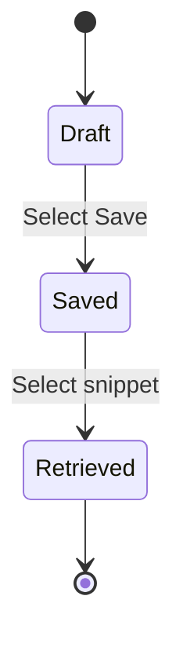
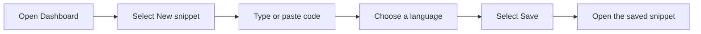

# Quick start

Welcome to API2. This guide takes you from a blank editor to a saved snippet you can find again in under five minutes.

## Before you begin

- Have API2 open. If you need help getting started, see System Requirements and Prerequisites or Installation and Setup Guide.
- Have a few lines of code ready to save. You can also use the example in this guide.

## What you'll see

The **Dashboard** is the main view. It lists saved snippets and includes the button you'll use to start a new one.

When you work with snippets, you'll use these main elements:

| UI element | Where you'll find it | What it does |
| --- | --- | --- |
| **Dashboard** | Main view | Lists saved snippets and starts the process |
| **New snippet** | Dashboard | Opens a blank editor |
| Code area | Editor | Large text box for typing or pasting code |
| Language selector | Editor | Menu that controls how code is color-coded |
| **Save** | Editor | Stores the snippet and adds it to your saved list |

## Step 1: Open the snippet editor

1. From anywhere in API2, open the **Dashboard**.
2. Select **New snippet**.
3. The editor opens in a blank state.

If your view labels the button **Create snippet** instead of **New snippet**, the rest of the steps are the same.

## Step 2: Write or paste code

1. Click inside the code area.
2. Type your code, or paste it from another document.
3. Watch the text become color-coded as you go.

The color coding helps you read keywords, strings, and other code elements at a glance. For more detail, see Syntax Highlighting.

## Step 3: Select the language or syntax type

1. Find the language selector above or beside the code area.
2. Select the language that matches your code.
3. The colors update to match the conventions for that language.

Choosing the right language helps the highlighting and organization features work as expected.

## Step 4: Save the snippet

1. Select **Save**.
2. API2 adds the snippet to your saved list on the **Dashboard**.
3. Stay in the editor or return to the **Dashboard** to confirm it was saved.

Your snippet moves through three simple states:

Figure: Snippet lifecycle



## Step 5: View your saved snippet

1. Open the **Dashboard**.
2. Find your new snippet in the saved snippet list.
3. Select the snippet to open it and view the full code.

Saved snippets remain available the next time you open API2. For more on how snippets are kept between sessions, see Data Storage.

## Example: Save a sample snippet

If you want a quick test, follow the same flow with a short SQL snippet.

1. Open a new snippet.
2. Paste the following into the code area:

```sql
SELECT name FROM users WHERE active = 1;
```

3. Set the language selector to **SQL**.
4. Select **Save**.
5. Open the **Dashboard** and confirm the snippet appears in the saved list.

Figure: Basic snippet creation flow


