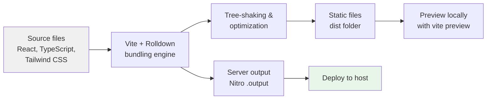

# Site building and bundling

Site building and bundling turns your site's source content, React components, and styles into a compiled, production-ready set of files you can host anywhere. This feature is for developers and site administrators who want to prepare a fast-loading site and control how the build runs.

## Who it's for

- **Developers** who build and maintain the site and want a reliable bundling pipeline with fast rebuilds.
- **Site administrators** who deploy the compiled site and want predictable, optimized output for a standard host or serverless platform.

## How it fits together

The build process transforms your source files through several stages:

## Key options

### Supply chain guard

If you use Bun as your package manager, the project enforces a 24-hour release-age guard on installed packages. Any package version published less than one day ago is skipped unless it is explicitly listed in the Bun configuration. A small set of Lovable packages is pre-approved to bypass this guard.

## Benefits

- **Smaller files**, unused code is removed through tree-shaking and dependencies are deduplicated, reducing download size.
- **Faster builds**, Rolldown's Rust-based bundling engine speeds up production builds compared to traditional JavaScript bundlers.
- **Static hosting ready**, the build outputs plain static files in a`dist` folder, deployable to any CDN or file host.
- **Server rendering support**, a Nitro server output is generated alongside the static files, with Cloudflare as the default target.
- **Local preview**, you can serve the production build locally with`npm run preview` before publishing.
- **Consistent dependency resolution**, the pinned Rolldown version and Bun release-age guard keep builds reproducible.
- **Clear diagnostics**, errors and warnings from the build are surfaced as readable console messages.

## Limits and boundaries

- **Beta server runtime**, the Nitro server output uses a beta release (3.0.260603-beta), which may change in future updates.
- **Pre-configured pipeline**, many build settings are supplied by the Lovable configuration package. Manually adding TanStack, Tailwind, path resolution, or environment-injection plugins can cause duplicate-plugin errors.
- **Pinned bundler version**, Rolldown is pinned to 1.2.1 through an override. Upgrading it requires changing the override in the package configuration.
- **SSR entry is fixed**, the server entry is redirected to the project's error-handling wrapper. Changing this redirect affects server-side rendering behavior.
- **Package age guard**, when using Bun, new package versions are blocked for 24 hours unless explicitly allowlisted. This can delay pulling freshly published bug fixes.
- **Lint scope**, the linter ignores the`dist`,`.output`, and`.vinxi` build folders, so generated output is not linted.
- **Build failures**, the build stops with an error message if compilation fails. Warnings are printed but do not stop the build.

## Related features

Learn more about the pieces that interact with site building and bundling:

- Performance Optimization, optional build optimizations for faster builds and smaller bundles
- CSS Optimization, minify and optimize CSS output for production
- TypeScript Module Aliases, how the`@` path alias is provided to theme and plugin developers
- Logging & Diagnostics, consistent console logging for build progress and warnings
- How to build production site, step-by-step instructions for running a production build
- System Requirements and Prerequisites, Node.js and package manager requirements
