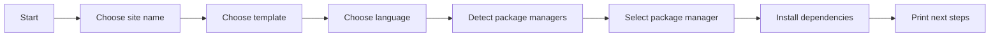
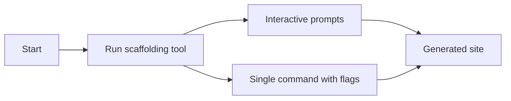

# Site scaffolding

Create a new Docusaurus website through a guided setup. Site scaffolding is for anyone who wants to start a new site and needs a working foundation without manual assembly.

## What it is

Site scaffolding asks a short series of questions, then generates a complete Docusaurus site. You choose a name, a starting template, and a language. The generator then copies the appropriate files, sets up the site identity, installs dependencies, and prints next-step guidance.

## Who it's for

Site scaffolding is for developers, technical writers, and teams creating a new documentation site, product site, or blog. It is especially useful when you want a recommended starting point instead of building every page and setting from scratch.

## What you get

When scaffolding completes, you have:

- a site homepage with a navigation bar and footer
- a documentation area with a tutorial and a sidebar that can be generated from your content
- a blog section with reading time and RSS and Atom feeds
- automatic light and dark mode that respects each visitor's system preference
- a built-in code highlighting theme for code examples
- standard workflows for local preview, production build, and publishing to GitHub pages

## Setup flow

The scaffolding tool walks you through a short sequence of choices. The following diagram shows the overall flow from start to a ready site.

Figure: Site scaffolding flow



The sections below cover each choice in more detail.

## Setup choices

### Site name and location

The generator asks **What should we name this site?** and suggests`website` as the default. You can enter a new folder name or choose the current folder by typing`.`. The location must be empty or must not already exist; otherwise, the generator asks for a different name.

### Starting template

You choose a template from a list. The recommended option is **classic (recommended)**. You can also choose **Git repository** to clone a public repository as your starting point, or **Local template** to use a folder already on your computer.

### Language

The generator asks **Which language do you want to use?** You can choose **JavaScript** or **TypeScript**. If you choose TypeScript, the selected template must include a TypeScript variant.

### Dependency installation

After the site files are created, the generator detects which package managers are available on your computer. If more than one is available, it asks you to **Select a package manager**. Your options are npm, yarn, pnpm, or bun, depending on what is installed. You can also skip automatic installation by using the`--skip-install` flag and install dependencies later yourself.

## After scaffolding

When setup finishes, the site folder is ready. You can navigate to it and run a local development server to preview changes, build static files for production, serve the built site locally, or publish to GitHub pages. The generator prints the exact commands for your chosen package manager and site path.

If dependency installation fails, the generated site files remain in place. You can navigate to the folder and retry installation there.

## Requirements and limits

- The generator checks your installed Node.js version before starting. The minimum version is specified in the tool's package requirements; if your version is too old, the tool stops and displays the requirement.
- A TypeScript variant must be available for the template you selected; otherwise, the generator stops with an error.
- Git repository URLs must begin with`https://` or`git@`.
- Local template folders must exist on your computer before you enter them.
- The destination folder must not already exist, and the current folder must be empty if you use it as the site location.
- The classic template includes default branding, such as **My Site**, that you can replace after scaffolding.
- Package manager detection looks for available tools on your system; if none are found, the tool defaults to npm.

## Using the command line

You can also run the scaffolding tool directly from the command line with flags to skip interactive prompts:

-`--package-manager <manager>`: specify npm, yarn, pnpm, or bun
-`--skip-install`: skip automatic dependency installation
-`--typescript`: use the TypeScript variant
-`--javascript`: use the JavaScript variant
-`--git-strategy <strategy>`: specify how to clone a git repository (deep, shallow, copy, or custom)

For example, to create a site named`my-docs` using the classic template in TypeScript with npm, all in one command:

```
npx create-docusaurus@latest my-docs classic --typescript --package-manager npm
```

The following diagram shows the two main paths through setup: interactive prompts or a single command with flags.

Figure: Interactive and command-line scaffolding paths



---

**Related:**

- Installation and Setup Guide
- Site Building & Bundling
- Blog
- Documentation
