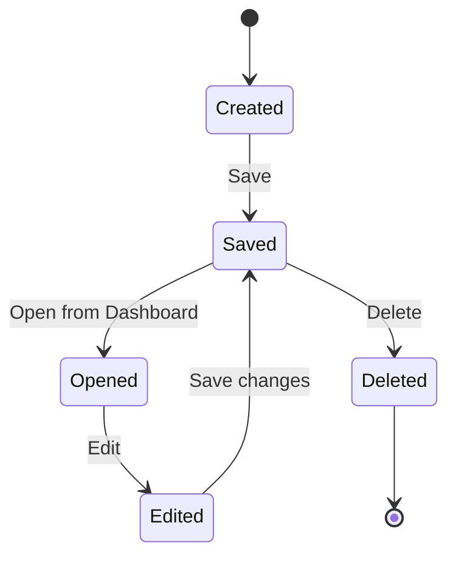
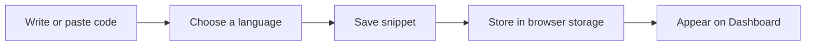

# Snippet management

Snippet Management is how you build and keep a library of reusable code snippets. You can save code you write often, organize it by language, and return to it later without hunting through old projects.

## What snippet management does

With snippet management you can:

- **Create** a snippet by entering code, a title, and a language.
- **Save** it so it is available the next time you open the application.
- **Find** saved snippets from the Dashboard.
- **Edit** a snippet when your code or approach changes.
- **Delete** snippets you no longer need.
- **Copy** code from a snippet into another project.

The application keeps your snippets in one central place: the Project Dashboard. From there you can open the code editor to write or adjust a snippet, with syntax highlighting applied as you type.

## Who snippet management is for

Snippet management is for developers who reuse the same small pieces of code and want a personal code library. It is useful whether you are:

- keeping quick references for SQL queries, Markdown templates, or other code patterns
- building a reference collection for yourself or a shared workspace
- reducing the time spent copying solutions from scattered notes

## How a snippet moves through the system

The snippet lifecycle has four main actions: create, retrieve, edit, and delete.

Figure: Snippet lifecycle

When you save a snippet, the application stores it locally in your browser, and it appears in your Dashboard.

Figure: Saving a snippet

## Storage and availability

By default, snippets are saved in **browser storage** on the device where you create them. This means:

- Your snippets remain available when you close and reopen the application.
- They are tied to the same browser and device.
- They are not automatically synced to another computer or browser.

For a deeper explanation of how data persists between sessions, see Data Storage.

## Snippet options

Each snippet has a few basic settings:

- **Language**, choose the programming or markup language for the snippet. This helps with organization, filtering, and syntax highlighting.
- **Title**, give the snippet a name you can recognize later.
- **Code**, the content of the snippet itself, written or pasted in the code editor.

## Benefits

- **Quick access to frequently used code**, save a snippet once and open it whenever you need it.
- **Less time rewriting**, reuse working code instead of recreating it from memory.
- **Organized references**, group and find snippets by language from the Dashboard.
- **A cleaner workflow**, keep small, reusable pieces separate from full projects.

## Limitations

- **Browser storage capacity**, local browser storage has a limited size, typically a few megabytes depending on your browser. Very large snippets or many stored snippets can eventually fill it.
- **Local-only storage by default**, snippets are stored on the current device and browser. They are not available on other devices unless you move or copy them yourself.
- **No built-in cloud sync**, the current storage does not synchronize snippets across devices or team members automatically.
