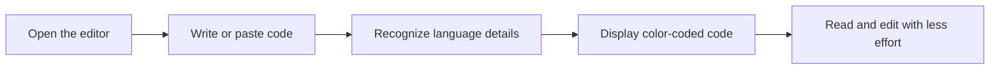

# Syntax highlighting

Syntax highlighting is the color-coded display of code in the Code Editor. Keywords, strings, punctuation, and other parts of your code appear in distinct colors so you can tell them apart at a glance. It is built for developers who read, write, and review code in more than one language.

## What it does

- Applies color coding automatically as you type or paste code into the editor
- Provides dedicated highlighting for **SQL** and **Markdown**
- Keeps snippets readable without any extra tools or setup

You don't need to install or configure anything. Syntax highlighting is already part of the snippet editor.

The diagram below shows the basic path from writing code to seeing a color-coded display.

Figure: Syntax highlighting experience in the editor

## Who it helps

Syntax highlighting helps anyone working with code snippets, including:

- Developers who switch between SQL queries and documentation-style Markdown
- People reviewing saved snippets and looking for a specific line or structure
- Anyone who wants to reduce eye strain while reading dense code

## Benefits

With color-coded display, you can:

- Recognize code structure instantly through distinct colors
- Scan long snippets more quickly
- Reduce eye strain when reading or editing for extended periods
- Spot keywords, values, and punctuation without reading every character

Syntax highlighting turns a wall of text into a readable, scannable view of your code.

## Supported languages

The built-in highlighter includes dedicated support for:

- **SQL**
- **Markdown**

These languages are covered by a compact, built-in highlighter that keeps the experience simple and fast. Other languages may not receive the same depth of color coding. For more on how snippets are stored and organized, see Snippet Management.

## Automatic language detection

When the application can recognize the language, highlighting applies automatically as you type. You do not need to select a language or change any settings to see the color-coded display.

Automatic recognition is most applicable to the supported languages, SQL and Markdown. If the editor cannot clearly identify the language, color coding may be limited.

## Built-in and lightweight

Syntax highlighting is built into the application rather than added from a separate package or service. There are no external highlighting libraries to install, update, or manage.

Because the highlighter is intentionally simple, it focuses on reliable SQL and Markdown support rather than trying to cover every possible language. This keeps the editor lightweight and responsive.

## What to keep in mind

- Highlighting is most complete for **SQL** and **Markdown**
- The color palette and depth of highlighting are intentionally simple
- Other languages may appear with less color detail or no automatic recognition
- You do not need to configure or enable anything to get started

These boundaries keep the editor fast and avoid the overhead of a larger external highlighting tool.
