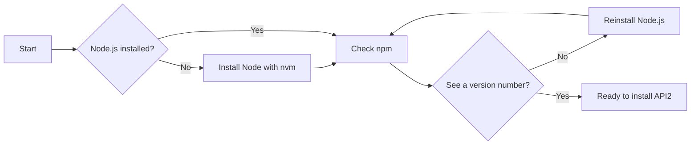

# System requirements and prerequisites

This page helps you confirm your computer is ready before you install and run API2. The setup uses Node.js and npm, so the main task is to verify those tools are available.

## What you need

| Requirement | What you need | How to check |
|---|---|---|
| Node.js | A current Long-Term Support release is recommended; the project does not pin one exact version |`node --version` |
| npm | Included with Node.js; the setup instructions use npm |`npm --version` |
| Git | Optional, but needed if you clone the project from its repository |`git --version` |

## Node.js

The provided setup information does not specify one minimum Node.js version. Use a current Long-Term Support release of Node.js, which is the safest choice for this project.

nvm, short for Node Version Manager, lets you install and switch between Node.js versions on your computer.

To check whether Node.js is already installed, open a terminal and run:

```
node --version
```

If you see a version number, Node.js is installed.

### Install Node.js with nvm

1. Open a terminal window.
2. Check whether nvm is installed by running`nvm --version`.
3. If nvm is not installed, install it using the nvm installation instructions referenced in the project setup guide.
4. Use nvm to install a current Long-Term Support Node.js release. Many nvm users run`nvm install --lts` to do this.
5. Run`node --version` again to confirm the installation.

## npm package manager

npm is the package manager used by this project. It is installed together with Node.js, so if Node.js is working, npm is normally available. You do not need to install pnpm or yarn.

To check npm, run:

```
npm --version
```

If you do not see a version number, reinstall Node.js with nvm and confirm npm is included.

## Operating system support

The provided project information does not list any operating system restrictions. You can use:

- Windows
- macOS
- Linux

The setup commands, including`node --version` and`npm --version`, work the same way on these systems.

## Disk and memory requirements

The project does not publish official minimum hardware requirements. For local development, use a computer that can comfortably run Node.js, npm, and a modern web browser. Make sure you have enough free disk space to install Node.js and the project dependencies.

## Browser compatibility

The project does not list specific browser versions. API2 provides a modern web interface, so use a current version of a major browser for the best experience:

- Chrome
- Edge
- Firefox
- Safari

Keep your browser updated to avoid display or interaction issues.

## Verify your environment

Figure: Environment readiness check



1. Open a terminal window.
2. Run`node --version`. Confirm that a version number appears.
3. Run`npm --version`. Confirm that a version number appears.
4. Optional: run`git --version` if you plan to clone the project.
5. If the commands return version numbers, your environment is ready.


Once your environment is ready, follow the Installation and Setup Guide to get API2 running locally. You can also try the Quick Start guide.
