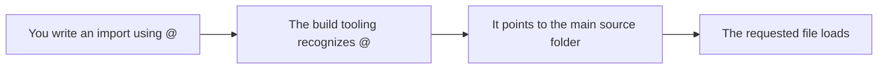

# TypeScript module aliases

TypeScript module aliases give you a short, stable shortcut for importing code from the project's main source folder. Instead of writing long, fragile paths that move whenever files move, you can use the built-in`@` shortcut. The shortcut is already configured for you, so it works the moment you start working in the project.

## Who this is for

This feature is for **developers who build or edit features in this project**. If you create new pages, components, utilities, or tests, TypeScript module aliases help you connect files to each other without worrying about where they sit in the folder structure.

## What it enables

TypeScript module aliases provide one primary shortcut:

- **`@` for the main source folder**. Use`@` at the start of an import to reach any file inside the project's main code folder. This replaces long relative paths such as`../../components/Button` with a stable path such as`@/components/Button`.
- **Consistent behavior in development and testing**. The same alias works whether you are running the app locally, building it for production, or running tests.
- **Fewer path mistakes**. Because the shortcut is fixed, you are less likely to introduce broken imports when you move or reorganize files.

Figure: How the @ alias points to the main source folder



The diagram shows the path an import takes when you use the`@` shortcut. You write the import, the build tooling resolves the shortcut, and the requested file loads.

## Key benefits

**Cleaner imports**. The alias removes deeply nested relative paths, making your code easier to read at a glance.

**Easier file moves**. When a file changes location, imports that use the alias remain valid as long as the file stays inside the main source folder.

**Fewer broken imports**. A fixed shortcut reduces typing errors and makes it easier to spot mistakes before they become runtime problems.

**Consistent developer experience**. The same alias works across development, production builds, and tests, so you can use one convention everywhere.

## How to use it

No setup is required. The alias is included in the project's build configuration. To use it, start an import with`@` and then provide the path from the main source folder:

```typescript
import { Button } from '@/components/Button';
```

Your development tooling automatically resolves the shortcut to the correct file.

## Options and configuration

The`@` alias is provided automatically by the project's build setup and test setup. You do not need to add it yourself.

- **Do not add the alias again manually**. The build configuration already registers the path shortcut. Adding it a second time can introduce duplicate settings and cause the app to break.
- **The same shortcut is available when running tests**. The test setup mirrors the alias, so imports stay consistent across the whole project.

## Limitations

- **The alias only points to the main source folder**. Files outside that folder are not covered by the`@` shortcut and must be referenced in another way.
- **Alias resolution happens during development and build**. The shortcut is resolved by the tooling before the app runs in a browser.
- **Adding extra aliases requires care**. If you need a shortcut for a different location, avoid duplicating the existing configuration. Any change should respect the build tooling that already handles module paths.

---

**Related topics:**

- Installation and Setup Guide
- Site Building & Bundling
